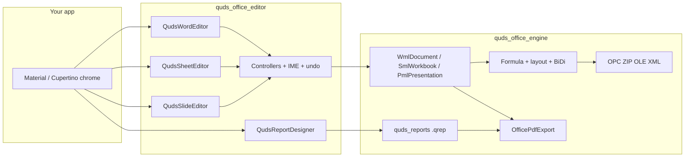

# Quds Office Suite

<p align="center">
  <strong>A production-grade Office stack for Dart and Flutter.</strong><br/>
  Pure Dart engine. Custom RenderBox editors. Word · Excel · PowerPoint · PDF · Band reports.
</p>

<p align="center">
  <a href="https://pub.dev/packages/quds_office_engine"></a>
  <a href="https://pub.dev/packages/quds_reports"></a>
  <a href="https://pub.dev/packages/quds_office_editor"></a>
  <a href="LICENSE"></a>
  
  
</p>

---

The core suite has an engine, reports library, Flutter editor and desktop app. This fork also carries the maintained standalone legacy DOC parser.

The current fork imports supported BIFF8 `.xls` files and Excel HTML tables into
editable XLSX workbooks, including shared-formula groups, palettes, font families
and HTML captions/header emphasis. Worksheet navigation commits valid drafts
on their original sheet and blocks navigation when a draft is invalid. Word
selection uses platform-specific bands; heading changes respect document styles
and theme colours. Shapes without text retain that distinction on export.
Complex Word fields keep their spans, and unsupported header/footer structures
retain their original XML and related payloads. Tracked-change import/save now
avoids repeated full scans. Preserved headers remain outside the editable model;
unsupported legacy spreadsheet formats, encryption and full native rendering
remain outside these guarantees.

The current ODS importer bounds expanded cells, XML, style and merge work;
it preserves supported column geometry, authored date/time formats, quoted
formula literals and cell/row/column style precedence. Bounded annotations retain
their coordinates and authors without becoming cell text. Unsupported repeated or
matrix formulas and ambiguous merged data are declined rather than clipped.
ODS pictures with supported local image references are carried into worksheet
drawings with bounded geometry; external resources are not fetched. Macro-enabled
and template spreadsheet saves preserve their original package type and opaque
VBA parts without executing macros.
Word step commands accept OOXML alignment/underline names; all 18 underline
styles survive serialization and a paragraph split retains its character style.
These are bounded import/edit contracts, not certification of native Word or
LibreOffice layout for every file.

Legacy VML pictures, rules and shapes are retained as opaque source content with relationship integrity checks; this preserves export bytes without claiming native rendering or editing of those objects.

The fork now deduplicates byte-identical Word media on export, reads supported symbol characters, and keeps sibling text boxes independent during import. Legacy DOC conversion writes canonical built-in style names and offers explicit recovery for damaged auxiliary features; recovery reports degraded output and remains opt-in.

The current fork also preserves spreadsheet comments, supported formula caches and frozen-pane anchors on save. Sheet sorting participates in undo/redo without losing cell locks or PDF borders; speaker-note edits participate in slide history and save revisions. Native fill regression fixtures are schema-valid and checked against independently authored expected files. See [the current capability and acceptance record](docs/office-capabilities-20261114.md) for tested behavior and [the remaining office-format backlog](docs/office-remaining-gaps.md) for open work.

Worksheet direction, frozen panes, row/column grid edits and selection formatting now participate in save revisions and undo/redo on their owning worksheet. Grid history preserves cell identity so earlier text and formatting commands remain usable after sorting or structural edits. DOCX import accepts block-level bookmark markers, repairs unpaired endpoints within their story, and retains duplicate content-control IDs already present in the source while rejecting additional duplicates. Decimal/unit measurements use finite fallbacks for malformed overflow values. Unsupported Word constructs and font/layout fallbacks remain fidelity boundaries.


Hosts can register their actual font families and styles for shared Word
layout, painting and PDF export. Unloaded families retain their names in the
document but paint with an explicit bundled fallback; they do not claim
unrelated font metrics. Font substitution, unsupported table topology and
unmodeled legacy DOC constructs remain fidelity boundaries, not guarantees of
pixel-identical Microsoft Office rendering. The parser mirror includes the
current compound-file, Unicode, field, embedded-object and numbering audits.

> **1.0 is out.** Both packages are stable and follow semantic versioning.
> See *What 1.0 brings* in the [engine](packages/quds_office_engine#what-10-brings)
> and [editor](packages/quds_office_editor#what-10-brings) READMEs.

| Package | Runtime | What it is | pub.dev |
| --- | --- | --- | --- |
| **[`quds_office_engine`](packages/quds_office_engine)** | Pure Dart | OOXML + OPC/ZIP + formulas + PDF 1.7 | [pub.dev/packages/quds_office_engine](https://pub.dev/packages/quds_office_engine) |
| **[`quds_reports`](packages/quds_reports)** | Pure Dart | `.qrep` band reports: templates, expressions, PDF / XLSX / DOCX | [pub.dev/packages/quds_reports](https://pub.dev/packages/quds_reports) |
| **[`quds_office_editor`](packages/quds_office_editor)** | Flutter | Interactive Word / Sheet / Slide / PDF surfaces and the report designer | [pub.dev/packages/quds_office_editor](https://pub.dev/packages/quds_office_editor) |
| **[`quds_report_studio`](apps/quds_report_studio)** | Flutter desktop app | Standalone report editor: open, design, preview, export `.qrep` | [Windows and Linux installers](https://github.com/MohammedAsaadAsaad/quds_office_suite/releases/tag/studio-v1.5.0) |

```text
┌─────────────────────────────────────────────────────────────┐
│                     your Flutter / Dart app                 │
├──────────────────────────────┬──────────────────────────────┤
│     quds_office_editor       │     quds_office_engine       │
│  QudsWordEditor              │  Docx / Xlsx / Pptx builders │
│  QudsSheetEditor             │  Wml / Sml / Pml models      │
│  QudsSlideEditor             │  Formula engine              │
│  QudsPdfViewer / Editor      │  PdfFile + OfficePdfExport   │
│  QudsReportDesigner          │  quds_reports (.qrep → PDF,  │
│  custom RenderBox canvases   │    XLSX, DOCX)               │
│         │                    │  OfficeIsolateOpen / Save    │
│         └────────────────────┤  OPC · ZIP · OLE · XML       │
│                              │  BiDi · shaping · fonts      │
└──────────────────────────────┴──────────────────────────────┘
```

The engine **never** imports `dart:ui` or Flutter. The editor **never** uses
`TextField`, `ListView`, or `InteractiveViewer` for the document surface.


<table>
  <tr>
    <td width="50%"><br/><b>Word</b>: paginated canvas, BiDi caret, outline, comments</td>
    <td width="50%"><br/><b>Excel</b>: virtualized grid, formula engine, charts</td>
  </tr>
  <tr>
    <td><br/><b>PowerPoint</b>: stage, animations, Morph, reverse playback</td>
    <td><br/><b>PDF</b>: open real files, find, annotate, forms</td>
  </tr>
  <tr>
    <td><br/><b>Report preview</b>: engine pagination, vector charts</td>
    <td><br/><b>RTL reports</b>: Arabic invoice with tafqeet and QR</td>
  </tr>
</table>

<table>
  <tr>
    <td width="33%"></td>
    <td width="33%"></td>
    <td width="33%"></td>
  </tr>
</table>

Chart gallery and a country shape map, rendered by the engine.

### Report output (rendered by the engine, no Flutter)

<table>
  <tr>
    <td width="33%"></td>
    <td width="33%"></td>
    <td width="33%"></td>
  </tr>
</table>

### Files from other suites

A DOCX written in LibreOffice Writer. On the left is LibreOffice's own PDF.
On the right is the engine's, made in pure Dart.


---

## About this fork (CrispStrobe)

The fork includes [Zotero reference support](docs/zotero-support.md): online
personal/group libraries, native desktop access without an API key, offline CSL
JSON, linked DOCX citation fields, bibliographies and undoable reference editing.
Unsynced desktop references support identity-checked metadata refresh and
individual previews; selected exports and formatted bibliographies require
Zotero 10+ database/version verification. The shared editor exposes the same
workflow to CrispCloud. Native desktop tools now open Zotero's citation picker
and document preferences, insert selected catalog sources, and refresh the
complete supported citation sequence through Zotero's CSL processor, including
style-dependent numbering, disambiguation and German *Ebd.* with locators.
Results apply atomically with undo/redo and native preference persistence.
Basic author-year text and individual previews remain explicit fallbacks.
Mixed inline formatting, note preview numbering and unsupported bibliography
layout have documented limits. Local tests and pinned real-processor fixtures
pass; live Zotero/Word acceptance and full native builds remain pending.

ODS imports include print areas, titles, names, auto-filters and same-workbook
range-source validation snapshots. Validation expansion has a shared two-million
source-cell work limit, checked before iteration and multiplication. Quoted sheet
names retain their spaces. Dynamic validation-source links remain a separate
fidelity boundary.

This fork is integrated with [CrispCloud](https://github.com/CrispStrobe/CrispCloud). Current shared features include source-preserving spreadsheet font geometry, explicit style-zero handling, guarded logical addressing for merged Word tables, custom tab controls, and feature-directed editing/validation workflows. The [follow-up report](docs/office-fidelity-followup-20261112.md) and [fidelity ledger](docs/office-fidelity-gaps.json) retain the tested contracts and remaining limits. Native receipts describe their exact original source trees.

Spelling, automatic German hyphenation and grammar work is tracked in the
[proofing roadmap](docs/PROOFING.md). It records the existing callback-only
spelling baseline, the MIT/BSD/Apache/MPL component and language-data policy,
implementation order, and the checks required before claiming each feature.

The [native spaCy handoff](docs/roadmaps/native-spacy/README.md) scopes the next
optional German analysis backend: C++/ggml in CrispEmbed, no Python runtime or
daemon in the app, and separate guarded grammar rules. It records source/model
pins, implementation tasks, validation criteria, and licensing decisions for a
fresh agent. This is a documented implementation plan, not an enabled backend.

Legacy `.doc`/`.dot` parsing and separate DOCX/DOCM conversion are maintained in [legacy-doc-parser](https://github.com/CrispStrobe/legacy-doc-parser). The engine exposes compatibility exports from the pinned workspace copy in `packages/legacy_doc_parser`; its `UPSTREAM.json` records the source and workspace-only patches. The suite's MIT license does not replace that dependency's MPL-2.0 license or its third-party notices.

Use Flutter **3.47.8**, pinned in `.fvmrc` and CI, and resolve dependencies from this workspace. This fork marks its modified engine/editor packages as source-only (`publish_to: none`) and records their sibling package dependencies explicitly. Use the complete workspace or its matching source checkout. Pub.dev badges describe published upstream packages; they do not imply that this fork's additions have been published.

This is the CrispStrobe fork of
[MohammedAsaadAsaad/quds_office_suite](https://github.com/MohammedAsaadAsaad/quds_office_suite).

### Why it exists

[CrispCloud](https://github.com/CrispStrobe/CrispCloud) opens, edits and saves
Word, Excel and PowerPoint files that live in users' cloud accounts. It uses
`quds_office_engine` and `quds_office_editor` from this repository through
local path overrides (`packages/` in CrispCloud, pinned to a commit of this
fork by a file-hash manifest). Two consequences drove the work here:

- **One fix, two places.** A fix made only in CrispCloud would never come back
  here, and a fix made only here would never reach the app. Every change lands
  in this fork first; CrispCloud then syncs the exact files and its hash guard
  fails if the copies drift.
- **Saving must not damage a user's file.** A cloud file manager that silently
  rewrites styles, drops notes or breaks a deck on save destroys data the user
  did not ask it to touch. So the goal was not "more features" but "what goes
  in comes out", proven by checks that do not trust our own serializer.

### What we changed

- **Native spreadsheet fills.** Unchanged fill XML is retained when other cell
  formatting changes. Explicit fill replacement and its undo/redo history are
  tracked separately, preserving native solid, pattern and gradient definitions
  that are outside the editor's simple colour controls.
- **Office preservation and edit admission.** Unsupported spreadsheet formulas
  retain typed caches through dependent calculations; formatting edits preserve
  imported SpreadsheetML style namespaces and properties. Word keeps native
  restriction modes and password metadata, with undoable tracking/protection
  changes. Signed XLSX/PPTX packages are refused for editing so a save cannot
  silently discard their signatures. Password verification and independent
  first-save rendering acceptance remain outside this increment; see
  [the recovery record](docs/office-recovery-20261114.md).
- **Word round-trip fidelity.** Footnote/endnote identity, source styles,
  numbering definitions, table styles and borders, hyperlinks in notes and
  headers, and explicit direct formatting (black / 11pt / zero spacing / left)
  are preserved instead of regenerated or flattened on save.
- **Notes layout.** Mixed and multiple notes per paragraph, multiline bodies
  and notes with styled runs, tables, drawings and links render. The note band
  is reserved during body layout, and long or rich notes paginate onto extra
  pages in source order instead of disappearing or overlapping the body.
- **Lists.** List commands allocate document-local definitions, so they no
  longer collide with imported list IDs; imported start values and Roman,
  alphabetic and padded-decimal formats are honored; list edits undo/redo.
- **Editable footnotes and endnotes.** The Word notes pane edits each note
  in place with minimal changes, so untouched runs keep their formatting,
  links, tables and pictures; typing in a note is one undo step; notes can be
  added and deleted from the pane (deleting also removes the mark in the body,
  and undo restores both). Before, editing a note replaced its whole body with
  unformatted text.
- **Editing and history.** Footnote insertion follows the caret, paragraph
  splits keep rich runs, and repeated undo/redo no longer mutates history
  snapshots.
- **PowerPoint templates and media.** Exported decks keep the imported slide
  masters, layouts and theme, and gain any missing master/layout/theme and
  notes-size parts PowerPoint requires. Pictures and charts are namespaced to
  the slide that owns them, so editing or reordering one slide can no longer
  overwrite another slide's media.
- **Word style cascade.** Sparse style definitions resolve through document
  defaults, `basedOn` chains, theme fonts and colours, and character and
  table-region styles, without freezing the inherited values into direct
  formatting, so they stay editable and the saved file keeps its styles.
- **Spreadsheet fidelity.** Source cell style records, pivot tables and live
  chart formulas are kept on save instead of being regenerated or flattened
  to values.
- **Fixes merged back from CrispCloud.** Imported footnote references render
  as superscript, visible Word selection and header/footer relayout, rotated
  PDF watermarks, and report-designer font and template-band fixes.
- **Lint clean.** Engine and reports analysis passes with `--fatal-infos`.

### How it is verified

Expected values are authored by hand (XML/JSON) or produced by other tools,
never by blessing our own output:

- A Python oracle reads exported ZIP/XML directly and compares it with the
  authored expectations; negative tests confirm it rejects damaged files.
- Import fixtures `native.pptx` and `native.xlsx` are produced by independent
  libraries (python-pptx, openpyxl; versions in `native-producers.json`), so
  import is tested against files our code did not write.
- A .NET tool (`tool/office-validation`) validates every exported package with
  the Open XML SDK.
- Save/reopen exports across DOCX, XLSX and PPTX, scripted edits, and a
  reviewed full-page visual goldens.
- The `office-fidelity` CI workflow runs the engine suite, semantic and negative
  controls, editor goldens, SDK validation and independent rendering. Current
  counts belong to the exact source checkpoint in the validation evidence.

Run it locally from `packages/quds_office_engine`: `dart test`, then
`bash tool/fidelity/check.sh`. Start with the
[current consolidation and validation report](docs/office-fidelity-consolidation-20261112.md)
and [bounded gap ledger](docs/office-fidelity-gaps.json). The
[operation guide](packages/quds_office_engine/tool/fidelity/README.md) documents
all import/edit/export commands. The historical
[coverage-branch guide](docs/office-fidelity-coverage-20261112.md) and its
[source-hashed coverage inventory](docs/office-coverage-gaps.json) record the
earlier `31add779` source snapshot. The
[11 November audit](docs/office-fidelity-audit.md) is a historical checkpoint,
not a measurement of the current branch.

### Known limits

- The goldens are reviewed on Linux with the suite's pinned Flutter 3.44.0.
  A prior single-page cross-platform comparison differed by about 0.6% of
  pixels; that observation is not a tolerance for the expanded corpus. Do not
  regenerate reviewed images from another platform to conceal a difference.
- Coverage reports measure executed instrumented lines and list absent source
  files; they do not measure branch coverage or establish correctness.
- Each closed gap names a bounded regression and its evidence. Partial and
  unsupported format/layout behaviors remain explicit in the current ledger;
  native Microsoft Office pixel equivalence is not certified.

---

## Why this suite

Most Dart “Office” libraries stop at writing a simple DOCX. Quds goes further:

- **Round-trip real files** — open Microsoft Office / LibreOffice packages, mutate the model, write them back.
- **Own the stack** — ZIP, Deflate, CFBF/OLE, XML, fonts, BiDi, and PDF are implemented here. Fewer mystery dependencies.
- **Many languages, many directions** — UAX #9 BiDi, Arabic shaping, mixed LTR/RTL, and logical caret movement live in the engine; the editor paints them.
- **Editors that look like Office** — paginated Word, virtualized Excel, a slide stage with Morph, wipe, push, and **reverse** slideshow playback.
- **Band reports** — `.qrep` templates with bands, groups, expressions, typed variables, charts, barcodes, and Arabic amount-in-words (`TAFQEET`), exported to PDF, XLSX, and DOCX. A detail band can print one page per table row, the report form of a mail merge (class certificates). A visual designer and a desktop app come with it.
- **100+ PDF report templates** — classified by domain, direction-aware, with distinct `SheetSkin` layouts (not text-only clones).
- **Server or UI** — generate reports on a CLI/server with the engine; embed the same models in Flutter with the editor.

---

## Install

### Engine only (CLI, server, isolates, Flutter)

```yaml
dependencies:
  quds_office_engine: ^1.5.0
```

### Reports only (CLI, server, isolates, Flutter)

```yaml
dependencies:
  quds_reports: ^1.5.0
```

```dart
import 'package:quds_reports/quds_reports.dart';
```

`QudsReportEngine` from that import is the engine's report engine. PDF, XLSX,
DOCX, expressions, `.qrep` packages, charts, and shape maps are all on it.
The designer is `package:quds_office_editor/quds_reports.dart`.

### Editor (pulls the engine and quds_reports)

```yaml
dependencies:
  quds_office_editor: ^1.5.0
```

This repository is a [Dart workspace](https://dart.dev/tools/pub/workspaces). From the root:

```bash
dart pub get
```

---

## 60-second engine tour

```dart
import 'dart:io';
import 'package:quds_office_engine/quds_office_engine.dart';

void main() {
  final theme = OfficeDocumentTheme.custom(
    palette: const OfficePalette(primary: '2B579A', accent: '217346'),
    rtl: true,
  );

  final docx = (DocxDocumentBuilder(theme: theme)
        ..heading('Quarterly report')
        ..paragraph('A pure Dart Office engine for many languages and directions.')
        ..table([
          ['Item', 'Value'],
          ['Files', '3'],
        ]))
      .build();

  final xlsx = (XlsxWorkbookBuilder(theme: theme)
        ..addSheet('Summary')
            .addRow(['Quarter', 'Revenue']))
      .build();

  final pptx = (PptxDeckBuilder(theme: theme)
        ..addCoverSlide(title: 'Quds Office', subtitle: 'Engine + Editor'))
      .build();

  File('report.docx').writeAsBytesSync(docx);
  File('book.xlsx').writeAsBytesSync(xlsx);
  File('deck.pptx').writeAsBytesSync(pptx);

  File('report.pdf').writeAsBytesSync(
    OfficePdfExport.fromBytes(docx, title: 'Quarterly report'),
  );
}
```

Full walkthrough: [`packages/quds_office_engine/README.md`](packages/quds_office_engine/README.md).

---

## 60-second editor tour

```dart
import 'package:flutter/widgets.dart';
import 'package:quds_office_editor/quds_office_editor.dart';

class WordHost extends StatefulWidget {
  const WordHost({super.key});
  @override
  State<WordHost> createState() => _WordHostState();
}

class _WordHostState extends State<WordHost> {
  late final WordEditorController controller = WordEditorController(
    config: const OfficeSurfaceConfig(
      textDirection: TextDirection.rtl,
      strings: OfficeStrings.english,
    ),
  );

  @override
  void initState() {
    super.initState();
    controller.insertHeading(text: 'New document');
  }

  @override
  void dispose() {
    controller.dispose();
    super.dispose();
  }

  @override
  Widget build(BuildContext context) {
    return QudsWordEditor(controller: controller);
  }
}
```

Same pattern for `SheetEditorController` + `QudsSheetEditor`,
`SlideEditorController` + `QudsSlideEditor`, `PdfViewerController` +
`QudsPdfViewer`, and `ReportDesignerController` + `QudsReportDesigner`.

---

## 60-second report tour

```dart
import 'dart:io';
import 'package:quds_office_engine/quds_reports.dart';

Future<void> main() async {
  // A ready-made template file from packages/quds_office_editor/templates/.
  final ReportTemplateInfo info = ReportTemplateInfo.decode(
    File('sales_performance.qrep').readAsBytesSync(),
  );
  // Pass `fonts:` (a ReportFontRegistry) to embed faces; Arabic needs one.
  final QudsReportEngine engine = QudsReportEngine.fromXml(info.xml);
  final Map<String, Object?> data = info.sampleData(); // or your own Map

  File('sales.pdf').writeAsBytesSync(await engine.exportToPdf(data));
  File('sales.xlsx').writeAsBytesSync(await engine.exportToExcel(data));
  File('sales.docx').writeAsBytesSync(await engine.exportToWord(data));
}
```

Design the same template visually with `QudsReportDesigner` (Flutter) or
in **Quds Report Studio**:

<table>
  <tr>
    <td width="50%"><br/>Inspector: steppers, segmented icons, switches, B/I/U</td>
    <td width="50%"><br/><code>{{ }}</code> autocomplete from data, functions, and formats</td>
  </tr>
</table>

Format, expressions, charts, templates: [engine README → Band reports](packages/quds_office_engine/README.md#band-reports-quds_reportsdart).
Designer and inspector: [editor README → Report designer](packages/quds_office_editor/README.md#report-designer).

Full walkthrough: [`packages/quds_office_editor/README.md`](packages/quds_office_editor/README.md).

---

## Run the apps

**Quds Report Studio**: the standalone report editor (open, design, preview, export).
Download it:

| Platform | Installer | Portable |
| --- | --- | --- |
| Windows 10/11 (x64) | [setup.exe](https://github.com/MohammedAsaadAsaad/quds_office_suite/releases/download/studio-v1.5.0/QudsReportStudio-1.5.0-windows-x64-setup.exe) | [zip](https://github.com/MohammedAsaadAsaad/quds_office_suite/releases/download/studio-v1.5.0/QudsReportStudio-1.5.0-windows-x64-portable.zip) |
| Debian / Ubuntu (x64) | [.deb](https://github.com/MohammedAsaadAsaad/quds_office_suite/releases/download/studio-v1.5.0/quds-report-studio_1.5.0_amd64.deb) | [tar.gz](https://github.com/MohammedAsaadAsaad/quds_office_suite/releases/download/studio-v1.5.0/QudsReportStudio-1.5.0-linux-x64.tar.gz) |

It becomes the app for `.qrep` files on its first run. Install and
uninstall steps are in the
[studio README](apps/quds_report_studio/README.md#download). Or run it from
source:

```bash
cd apps/quds_report_studio
flutter run -d linux     # or windows, macos
```

**Quds Office Studio**: the editor example, a desktop workspace with ribbons, samples, and OS window chrome:

```bash
cd packages/quds_office_editor/example
flutter run
```

The engine example writes a gallery of Word / Excel / PowerPoint files **and** their PDFs:

```bash
cd packages/quds_office_engine
dart run example/rich_export_gallery.dart
```

---

## Architecture



| Layer | Lives in | Rule |
| --- | --- | --- |
| Models, IO, layout, formulas, PDF | `quds_office_engine` | No Flutter |
| Painting, hit-testing, IME, gestures | `quds_office_editor` | `RenderBox` / `LeafRenderObjectWidget` only |
| Ribbons, file dialogs, window buttons | **your** host (or the studio example) | Material is allowed here |

---

## Repository map

```text
quds_office_suite/
├── packages/
│   ├── quds_office_engine/     ← publish this to pub.dev
│   ├── quds_reports/           ← publish this to pub.dev
│   └── quds_office_editor/     ← publish this to pub.dev
│       └── example/            Quds Office Studio (not published)
├── apps/
│   └── quds_report_studio/     standalone report editor (not published)
├── docs/                       MISSION, STANDARDS (limits), PDF, PUBLISHING,
│                               office-fidelity-audit, coverage gaps
├── tool/office-validation/     Open XML SDK validator used by CI
└── LICENSE                     MIT
```

---

## Publishing

Packages are published **separately**, engine first, then reports, then the editor:

```bash
cd packages/quds_office_engine && dart pub publish
cd packages/quds_reports && dart pub publish
cd packages/quds_office_editor && flutter pub publish
```

Step-by-step, dry-run, and versioning: [`docs/PUBLISHING.md`](docs/PUBLISHING.md).

---

## Contributing

See [`CONTRIBUTING.md`](CONTRIBUTING.md). Issues and pull requests are welcome.

## License

[MIT](LICENSE) © Mohammed Asaad Asaad. Fork changes © CrispStrobe, same license.
