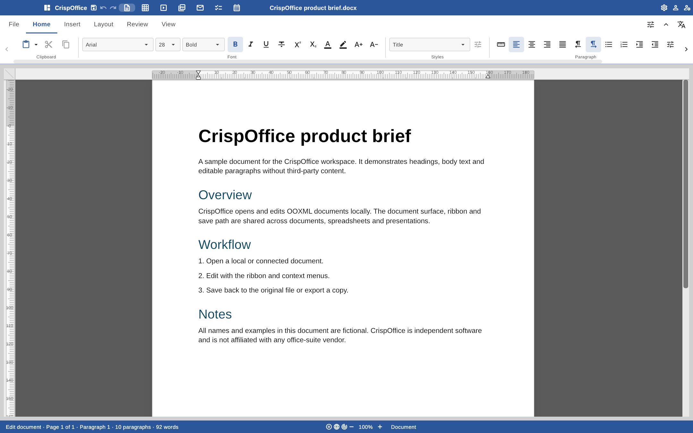
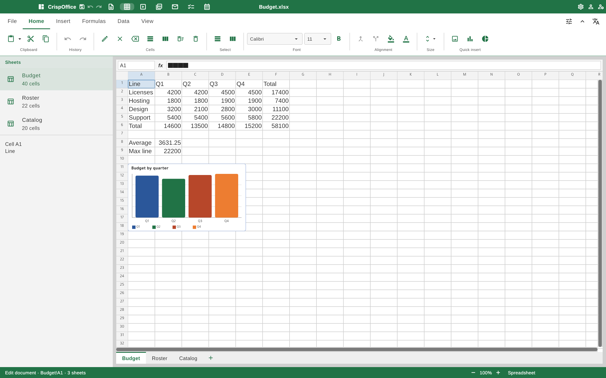
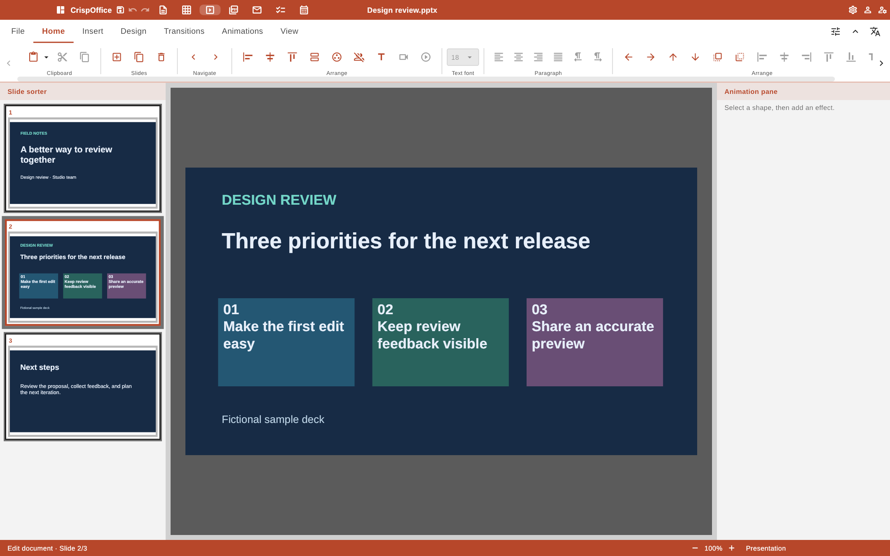
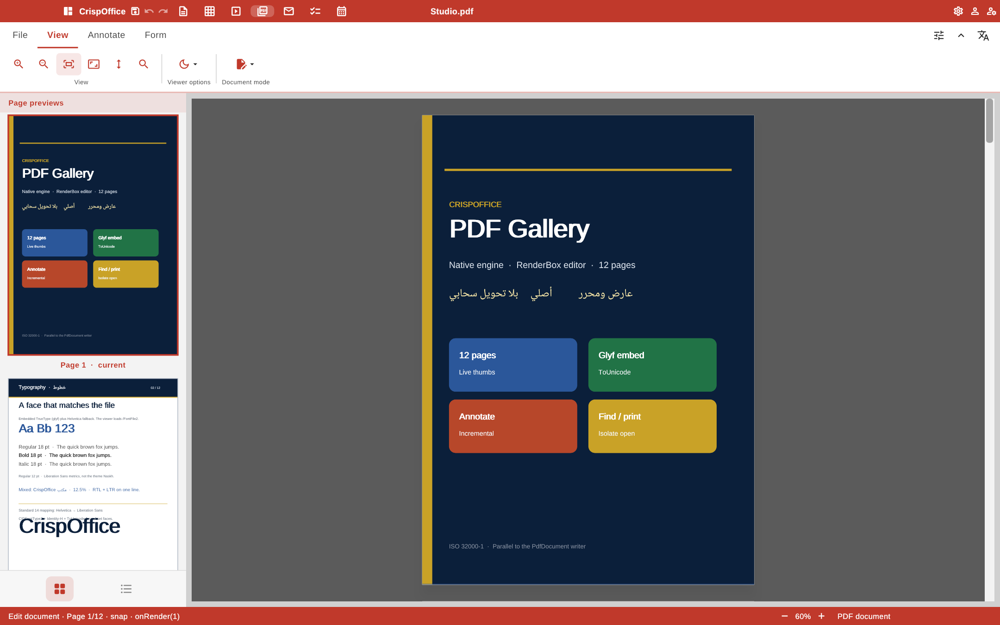

# CrispOffice

CrispOffice is an office workspace for documents, spreadsheets, presentations,
PDF, mail, tasks, and calendars. Its pure-Dart document engine also powers the
Flutter editing surfaces and report designer.

CrispOffice began as a fork of
[Quds Office Suite](https://github.com/MohammedAsaadAsaad/quds_office_suite) by
Mohammed Asaad Asaad. The engine is also used by
[CrispCloud](https://github.com/CrispStrobe/CrispCloud).

## Workspace

| Area | What you can do |
| --- | --- |
| **Documents** | Edit DOCX, use comments and tracked changes, work with tables and fields, and manage citations with Zotero. Paste formatted text and images, or drop images onto the page. |
| **Spreadsheets** | Edit XLSX, calculate formulas, make charts, and use conditional formatting and validation. Import legacy XLS and exchange ODS files. |
| **Presentations** | Edit PPTX slides, shapes, and text, with animations, transitions, and a presenter view. |
| **PDF** | Read, annotate, fill forms, and organise pages. |
| **Mail, Tasks, and Calendar** | Connect accounts and work in dedicated views. Read, write, and sync capabilities depend on the provider. |
| **Reports and automation** | Design band reports for PDF, XLSX, or DOCX export. Use the documented MCP bridge and supported macro subsets. |

## Screenshots

Captured from CrispOffice using sample documents.

<table>
  <tr>
    <td width="50%"><br/><b>Documents</b></td>
    <td width="50%"><br/><b>Spreadsheets</b></td>
  </tr>
  <tr>
    <td><br/><b>Presentations</b></td>
    <td><br/><b>PDF</b></td>
  </tr>
</table>

## Desktop shortcuts

| Action | macOS | Windows and Linux |
| --- | --- | --- |
| Paste with source formatting | Cmd+V | Ctrl+V |
| Paste as plain text | Cmd+Shift+V | Ctrl+Shift+V |
| Insert a line break inside a cell | Option+Enter | Alt+Enter |
| Print with preview | Cmd+P | Ctrl+P |
| Export to PDF with preview | Cmd+Shift+P | Ctrl+Shift+P |

Print and PDF export share controls for paper size, orientation, margins,
scaling, borders, and page range.

## Run from source

Use the Flutter SDK version in [.fvmrc](.fvmrc).

```bash
git clone https://github.com/CrispStrobe/CrispOffice.git
cd CrispOffice
flutter pub get
cd packages/quds_office_editor/example
flutter run -d macos
```

On Windows or Linux, select the corresponding desktop device.

## Engine and packages

- [quds_office_engine](packages/quds_office_engine) provides document models,
  file I/O, formulas, layout, and PDF export in pure Dart.
- [quds_office_editor](packages/quds_office_editor) provides Flutter editing
  surfaces for documents, spreadsheets, presentations, and PDF.
- [quds_reports](packages/quds_reports) and
  [Report Studio](apps/quds_report_studio) provide report templates, editing,
  and export.
- The [Mail](docs/roadmaps/mail/README.md) and
  [Tasks](docs/roadmaps/tasks/README.md) roadmaps track provider capabilities
  and sync coverage.

Layout can vary between applications, especially for complex documents.
See the [format fidelity record](docs/office-capabilities-20261114.md) and
[remaining gaps](docs/office-remaining-gaps.md) for details.

## Contributing and licence

See [CONTRIBUTING.md](CONTRIBUTING.md) for development and verification.
CrispOffice is distributed under the [MIT licence](LICENSE).
