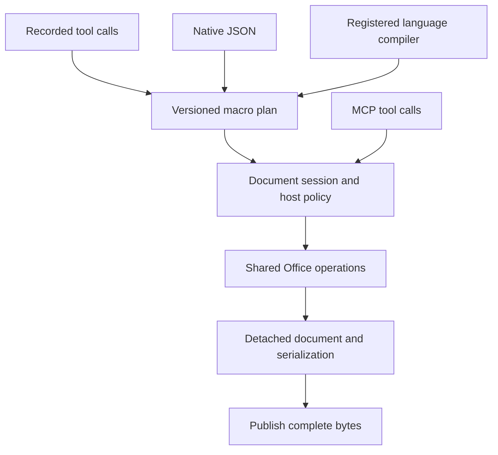

# Office macros, MCP, and language extensions

The fork provides explicitly invoked, parameterized native macros for Word,
spreadsheets, and presentations. The shared document operations power macro
playback, direct MCP tools, and the existing fidelity command runner.
The portable entry point is
`package:quds_office_engine/quds_office_automation.dart`.

This is a headless engine capability with a command-line runner and an MCP
stdio bridge. The bundled [`vba-excel` dialect](VBA_MACROS.md),
[`vba-word` dialect](VBA_WORD_MACROS.md), and
[`vba-powerpoint` dialect](VBA_POWERPOINT_MACROS.md) compile explicitly selected source into
the same native plans. Their shared language includes reusable in-module procedures, scalar functions, explicit
`ByVal` arguments, fixed and dynamic one-dimensional scalar arrays, bounded
`For`/`For Each`/`Do`/`While` loops, `Select Case`, and early exits. Its compiler evaluates those constructs before execution; document
values are not available to source logic.
Dynamic arrays support `ReDim`/`Preserve` and `Erase`, and `Option Base` sets
omitted lower bounds. String intrinsics, explicit Variant `Empty`/`Null`,
state predicates and bounded conversions operate on source values. Empty cell
writes clear values/formulas; Null publication fails before a plan is returned.
The Word adapter targets explicit body and independent header/footer paragraphs,
inserts text before their content, and applies supported font and paragraph formatting. It also targets
explicit existing sections for eight `PageSetup` geometry setters: page width
and height, four margins, and header/footer distances. Its ranges retain
the native paragraph boundaries. Word formatting includes all underline styles,
strikethrough, indentation and pagination. The continuation adds small caps,
superscript/subscript, fixed-palette highlighting, explicit active-document
aliases and `Paragraphs.Item`. The PowerPoint adapter targets explicit top-level
slide shapes for text, font, alignment and geometry edits, with source-preserving
formatting and a strict native collection identity guard. Its continuation adds
text-frame anchors, typed formatting helpers and bounded slideshow transitions.
The continuation passed its local compiler/native, CLI/MCP, strict analysis
and VM/JavaScript gates; see the
[executed qualification record](validation/office-vba-continuation-20261120/README.md).
The [parity roadmap](VBA_PARITY_ROADMAP.md) records remaining language/runtime
work and broader application objects.
It does not add a ribbon editor, a full VBA interpreter, document-open events,
or editor undo integration. Existing opaque VBA project bytes remain inert and
are preserved by the Office serializers.

## Execution model



A session owns a copy of the input bytes. Each invocation opens another detached
model, applies its operations in order, recalculates when spreadsheet values,
formulas, merges, or sheet identity/order change, and serializes it. Formatting,
pane geometry, and unmerging preserve existing formula caches. Only a completely
successful invocation replaces the session
bytes and increments its revision. A failing later operation, serialization
error, cancellation, deadline, or output-size refusal leaves the session's
previous bytes and revision unchanged. Zero-step plans still validate the
document family and edit admission, but preserve the bytes and revision.

`validate` executes the same operations and serialization on a detached copy;
it does not publish, change revision, or append to a recording. It can therefore
detect document-dependent errors such as an invalid paragraph or cell range.
An empty plan checks admission without rewriting the file.

The CLI and stdio bridge write a temporary file beside the selected output and
rename only after success. A stdio persistence failure returns a tool error and
terminates that session before accepting another mutation. This establishes
whole-document publication; it is not a power-loss durability guarantee or a
transaction spanning external resources.

## Native macro format

Save macros separately, for example as `monthly.qudsmacro.json`:

```json
{
  "version": 1,
  "name": "Set report title",
  "format": "xlsx",
  "parameters": {
    "title": { "type": "string" }
  },
  "steps": [
    {
      "tool": "xlsx.cellValue",
      "arguments": {
        "sheet": 0,
        "cell": "A1",
        "value": { "$parameter": "title" }
      }
    },
    {
      "tool": "xlsx.cellFormat",
      "arguments": { "sheet": 0, "cell": "A1", "bold": true }
    }
  ]
}
```

The envelope requires `version`, `name`, `format`, and `steps`. `parameters` is
optional. Supported document families are `docx`, `xlsx`, and `pptx`, including
their macro-enabled and template package variants. The actual input package
must match the selected family. The CLI requires the exact same input/output
filename extension so, for example, an XLSM is not mislabeled as XLSX.

Every declared parameter is required at invocation. Types are `string`, `number`,
`integer`, `boolean`, and `json`; there are no automatic string-to-number
conversions. `json` allows null and finite JSON values. Unknown parameters and
unknown envelope, step, or operation fields fail explicitly.

Substitution is structural. A map containing only `"$parameter"` inserts the
named value, including at nested positions. It is not string interpolation.
Parameter values containing quotes, dollar signs, or JSON-looking text remain
literal values. Use `{ "$literal": value }` to include a parameter-looking
object literally. Parameter values themselves are never interpreted again.

Numeric document indexes follow the existing command runner: sheets, sections, paragraphs,
slides, runs, rows, and columns are **zero-based**. Spreadsheet cell and range
addresses use A1 notation. Spreadsheet `sheet` arguments also accept a worksheet
name, matched case-insensitively against the document at the time of each step.
Missing or ambiguous names fail; they never fall back to the first sheet.
Use the inspection tool to obtain valid targets.
Each macro targets one document and contains an ordered list of calls; branching,
loops, recursive macro calls, timers, and application events are not part of
the native version 1 plan. The Excel VBA compiler expands supported loops and
evaluates supported conditions, Case selections, and procedure calls before
returning that finite plan. Conditional loops consume the shared work budget
even when their bodies emit no operations. Helpers and loops cannot raise host
limits.

## Command line

After resolving the repository workspace dependencies, run these commands from
`packages/quds_office_engine`:

```bash
dart run tool/macros/office_macro.dart operations
dart run tool/macros/office_macro.dart inspect input.xlsx
dart run tool/macros/office_macro.dart validate input.xlsx \
  example/macros/monthly_totals.qudsmacro.json \
  example/macros/monthly_totals.parameters.json
dart run tool/macros/office_macro.dart run input.xlsx \
  example/macros/monthly_totals.qudsmacro.json output.xlsx \
  example/macros/monthly_totals.parameters.json
```

The committed spreadsheet example writes title/revenue/cost cells, formats the
heading, adds a net formula, and freezes the first row. Other examples cover a
Word heading and presentation notes. The runner prints a JSON receipt on success
and a JSON diagnostic to stderr on failure. `compile SOURCE.json OUTPUT.json`
compiles a source envelope without running it; the default registry accepts
`quds-json`, `vba-excel`, `vba-word`, and `vba-powerpoint`.

For an explicitly selected VBA source file:

```bash
dart run tool/macros/office_macro.dart compile-vba \
  example/macros/monthly_totals.bas monthly.qudsmacro.json
dart run tool/macros/office_macro.dart validate-vba \
  input.xlsx example/macros/monthly_totals.bas
dart run tool/macros/office_macro.dart run-vba \
  input.xlsx example/macros/monthly_totals.bas output.xlsx
```

These commands default to the parameterless `Main` procedure and accept a final
optional entry-point name. The [VBA dialect guide](VBA_MACROS.md) specifies the
supported syntax, object members, compiler limits, and deliberate exclusions.

For Word source, select the Word commands explicitly:

```bash
dart run tool/macros/office_macro.dart compile-word-vba \
  example/macros/word_report.bas word-report.qudsmacro.json
dart run tool/macros/office_macro.dart validate-word-vba \
  input.docx example/macros/word_report.bas
dart run tool/macros/office_macro.dart run-word-vba \
  input.docx example/macros/word_report.bas output.docx
```

They have the same optional entry-point argument and output-preservation rules.
The input must contain the explicitly selected paragraphs and sections. Word macro-enabled
and template extensions retain the same-extension requirement; embedded projects
remain inert. The [Word dialect contract](VBA_WORD_MACROS.md) describes paragraph
and section selection, text boundaries, point units and supported formatting. For MCP,
use a source envelope with `language: "vba-word"` and `format: "docx"`, then
validate or execute the returned native plan through the same management tools.

For PowerPoint source, use `compile-powerpoint-vba`, `validate-powerpoint-vba`,
and `run-powerpoint-vba` with the same argument order, or use the source envelope
`language: "vba-powerpoint"`, `format: "pptx"`. See the
[PowerPoint contract](VBA_POWERPOINT_MACROS.md) and
`example/macros/powerpoint_report.bas` for exact shapes, units and supported
formatting. Native `shapeText`, `shapeFormat`, `shapeTextFrame`, and
`shapeGeometry` accept an exact `shapeName` instead of a numeric `shape`. Compiled PowerPoint plans also
request `topLevel: true`, which refuses groups and unmodeled native objects
instead of applying Office indices to flattened shapes.

Native `pptx.shapeTextFrame` accepts `anchor: "top"`, `"center"`, or `"bottom"`
and/or `marginLeft`, `marginTop`, `marginRight`, `marginBottom` in points.
Margins require exact nonnegative integer EMUs within signed Long bounds;
one point is 12,700 EMUs. The operation requires at least one property,
validates all supplied fields before mutation, preserves omitted sides and
uses the same text-shape and top-level collection guards. Native
`pptx.slideTransition` updates only the supplied `kind`, `direction`,
`durationMs`, and `advanceOnClick` fields; `kind` is optional. Omitted fields,
including automatic advance timing, retain their current values. Source-level
`SlideShowTransition.Duration` is expressed in seconds and compiles to exact
integer milliseconds. Slide visibility uses the existing `pptx.slideHidden`.

Native `docx.runFormat` additionally accepts Boolean `smallCaps`, `superscript`,
and `subscript` fields. A single native call must not provide both script-mode
fields. Enabling a mode selects it; disabling it preserves an existing opposite
mode. `smallCaps: true` writes an explicit AllCaps-off override. Highlighting
uses the existing `highlight` field with a palette RGB color or `null` to clear.
These operations retain the ordinary nonempty text-range requirement.

Generic native paragraph operations also accept `story: "header"`, `"footer"`,
`"firstHeader"`, `"firstFooter"`, `"evenHeader"` or `"evenFooter"`, with a
zero-based `section` and story-local `paragraph`. These selectors require an
existing modeled, independently owned paragraph story. Ambiguous references,
shared or inherited header/footer topology, and unmodeled source content in
rewritten stories are refused before editing. Selecting a preserved opaque
story is refused; independent unselected opaque stories remain preserved.
The separate native `headerFooterText` creation/replacement
operation retains its existing contract. The source adapter uses the generic
paragraph operations; it does not create stories. See the
[Word header/footer contract](VBA_WORD_MACROS.md#existing-header-and-footer-paragraphs).

Native `docx.tabStop` upserts one custom stop on an explicit `paragraph`, with
required `position` in points and optional `alignment` (`left`, `center`,
`right`, `decimal`; default `left`) and `leader` (`none`, `dot`, `hyphen`,
`underscore`; default `none`). Positions must be finite exact twentieth-points
in `-1584..1584`. Native `docx.clearTabStops` clears the selected paragraph's
currently effective explicit custom-tab definitions resolved by Quds, including inherited stops,
using native position-specific clear records. It preserves default-tab interval
settings and indentation. Both operations accept the usual explicit story
selectors; VBA tab-stop methods emit body or explicitly selected header/footer
paragraph selectors. Partial tab edits
preserve unrelated source XML and inheritance. Table inheritance uses the
existing whole-table, horizontal-band and first-row layers; other conditional
table regions remain unmodeled. Ambiguous source definitions
are rejected before mutation; see the [Word contract](VBA_WORD_MACROS.md#custom-paragraph-tab-stops).

Native `docx.pageSetup` sets one section measurement with three required fields:
`section` is a zero-based index; `property` is exactly `width`, `height`, `top`,
`bottom`, `left`, `right`, `header`, or `footer`; and `points` is a finite number
in exact `0.05`-point increments, bounded by `2147483647` native twips.
Dimensions require at least one point; margins and header/footer distances
require nonnegative values. Each step checks the current detached page body
and uniform-column text width, so reduce margins before shrinking a page if
needed. Failed geometry or source guards roll back the complete macro.
The handler preserves unrelated sparse XML, namespace aliases and opaque macro
parts. Width/height setters also clear native paper-size code, including on
same-value writes. Unsupported native measurements, gutters, ambiguous geometry,
custom columns, alternate section properties, `mc:ProcessContent` markup, and mirrored/book-fold settings
are refused. See the [complete section contract](VBA_WORD_MACROS.md#section-page-setup)
and [runnable example](../packages/quds_office_engine/example/macros/word_page_setup.bas).

Native `docx.pageOrientation` requires zero-based `section` and `orientation`
(`portrait`, `landscape`, or `toggle`). A change swaps the section's dimensions
while retaining named margins, header/footer distances, column settings and
printer paper code. Same-value writes retain dimensions but explicitly own
orientation, including on square pages. Runtime resolution follows previous
transaction operations and refuses inconsistent/ambiguous source orientation,
unsupported page settings or resulting invalid geometry.

Native `docx.sectionStart` requires zero-based `section` and `kind`
(`continuous`, `nextPage`, `evenPage`, or `oddPage`). It owns only the selected
native section-start attribute, preserves unrelated source properties and
history, and refuses duplicate native type/value or ambiguous section identity.
New-column starts are unsupported. Both operations use the same allowlists,
recording and atomic publication boundary as other mutations. See the
[section-controls contract](VBA_WORD_MACROS.md#section-orientation-and-start-controls)
and [runnable example](../packages/quds_office_engine/example/macros/word_sections.bas).

Native `docx.listDefault` takes `paragraph` and Boolean `numbered`. It toggles
off matching native paragraph numbering or applies a deterministic Quds
single-level default when the kind differs. Native `docx.removeNumbers` takes
`paragraph` and optional `numberType` (`all`, the default, or `paragraph`).
The `all` form refuses selected LISTNUM fields; paragraph-only removal preserves
supported field packets. Both operations refuse field boundaries that serialization
would discard as unbalanced, including boundaries in unrelated stories. Both
write persistent paragraph-numbering suppression when clearing and
preserve unrelated native content. These operations address body paragraphs;
the [ListFormat contract](VBA_WORD_MACROS.md#paragraph-list-formatting) documents
source arguments, default layout, inheritance, ambiguity guards and limits.

The `example/macros/procedural_report.bas` example demonstrates shared heading
and row helpers, `Worksheet`/`Range` arguments, and nested scalar functions.
The `example/macros/control_flow_report.bas` example combines conditional loops
and `Select Case` to create six synthetic rows in `Summary`, emitting 35 native
operations and a formula total of 1,575. The
`example/macros/array_report.bas` example uses typed arrays, indexed reads/writes,
`LBound`/`UBound`, scalar helpers, and both `For Each` forms to emit 24 native
operations. Its source and worksheet totals are both 850. All examples use the
same CLI and MCP compilation, validation, and execution paths.
The `example/macros/dynamic_array_report.bas` example grows and shrinks its
source arrays, preserves retained entries, and demonstrates reallocation after
`Erase`, also producing 24 native operations and matching totals of 850.

## Dart embedding and recording

```dart
import 'package:quds_office_engine/quds_office_automation.dart';

final session = OfficeMacroSession(
  inputBytes,
  format: OfficeMacroFormat.xlsx,
  policy: OfficeMacroPolicy(
    allowedTools: {'xlsx.cellValue', 'xlsx.cellFormat'},
    maxSteps: 100,
  ),
);

session.startRecording('Format title');
await session.callTool('xlsx.cellValue', {'cell': 'A1', 'value': 'Summary'});
await session.callTool('xlsx.cellFormat', {'cell': 'A1', 'bold': true});
final recorded = session.stopRecording();
final macroJson = recorded.encode();

final anotherSession = OfficeMacroSession(
  anotherInputBytes,
  format: OfficeMacroFormat.xlsx,
);
await anotherSession.validate(OfficeMacro.parse(macroJson));
final receipt = await anotherSession.run(recorded);
final completeOutputBytes = anotherSession.bytes;
```

Only successful `callTool` invocations enter a session recording. Failed calls,
validation, macro playback, and macro-management tools do not record additional
steps. Arguments are deeply copied and made immutable; later caller changes
cannot rewrite the recording. Recording step and byte limits are checked before
an operation can publish, so a successful edit is never followed by a recording
overflow error.

`OfficeMacroRecorder` is also available to existing hosts. Call its `record`
method only after the host's own canonical command succeeds. A native editor
must separately settle pending edits, enforce its readonly configuration,
compare its own document revision before applying the result, and commit the
replacement through an appropriate history operation. The existing editor
`CommandPipeline.beginBatch` is not used as a macro transaction: it does not
provide nested rollback semantics. This change makes no single-undo claim.

## MCP integration

For a local MCP client, launch one process per explicitly selected document:

```bash
dart run tool/macros/office_macro_mcp.dart input.xlsx output.xlsx
```

An example stdio client configuration is:

```json
{
  "mcpServers": {
    "quds-office": {
      "command": "dart",
      "args": [
        "run",
        "/absolute/path/quds_office_suite/packages/quds_office_engine/tool/macros/office_macro_mcp.dart",
        "/absolute/path/input.xlsx",
        "/absolute/path/output.xlsx"
      ]
    }
  }
}
```

For an existing server, embed `OfficeMacroMcp(session)` and route `tools/list`
and `tools/call` to `listTools` and `callTool`. `handleMessage` additionally
provides a bounded JSON-RPC lifecycle for the stdio bridge. It negotiates the
supported 2025-11-25, 2025-06-18, and 2024-11-05 protocol revisions and handles
initialize, initialized notification, ping, tools/list, and tools/call. It does
not implement HTTP, resources, prompts, sampling, tasks, or protocol cancellation.
The Dart runtime exposes cooperative cancellation separately.

| Tool family | Behavior |
| --- | --- |
| `docx.*`, `xlsx.*`, `pptx.*` | Canonical document operations for the open family, filtered by host policy |
| `office_document_inspect` | Inspect document targets and current revision |
| `office_macro_record_start` | Start recording with a `name` |
| `office_macro_record_stop` | Return the recorded macro |
| `office_macro_validate` | Dry-run `macro` and optional `parameters` |
| `office_macro_run` | Run `macro` and optional `parameters`, then publish complete output |
| `office_macro_compile` | Compile a `source` envelope using a registered dialect |

Operation names and accepted fields come directly from the shared catalog.
Operation field schemas intentionally leave individual field types unspecified;
the existing handlers remain the authoritative validators for required fields,
types, ranges, and document-dependent constraints. Macro/source envelopes have
explicit schemas. This avoids maintaining conflicting validators, but means a
client learns some operation requirements from a returned validation error or
the established fidelity command documentation.

Tool success/domain-error results include `structuredContent` and the same
JSON serialized in a text content block. Domain errors set `isError: true`.
Unknown tools and malformed protocol requests return JSON-RPC errors. Stdout
contains protocol messages only; diagnostics go to stderr. The process has no
network listener, and tool calls cannot choose another document or output path.
The stdio wire format and result conventions follow the
[MCP tools specification](https://modelcontextprotocol.io/specification/2025-11-25/server/tools)
and [stdio transport specification](https://modelcontextprotocol.io/specification/2025-11-25/basic/transports).

## Host policy and document admission

Default limits are 1,000 operations, 1 MiB native JSON or source, 64 MiB input
and output document bytes, 128 MiB expanded package bytes, 4,096 ZIP members,
100,000 cumulative cell visits, 256 declared parameters, JSON nesting depth 32,
and a 30-second cooperative deadline. The format's absolute step ceiling is
10,000. Hosts can lower limits through `OfficeMacroPolicy`.

Package admission checks declared sizes and actual bounded inflation, including
ZIP members with dishonest size headers. Merge rectangles and Word table growth
are charged before allocating cells. Parameter expansion is charged while
traversing values and before appending another resolved call, so a small plan
cannot bypass its byte limit by repeatedly expanding a large parameter.
Aggregate recordings and programmatic compiler output have the same bounds.
Near the byte ceiling, macro serialization falls back to compact JSON so its
own parser can read the saved result.

The deadline is checked between operations and before publication; it cannot
preempt a synchronous engine operation. These checks bound specific package and
command workloads; they are not a hard CPU/memory sandbox. A host requiring hard
resource isolation should run the engine in a separately constrained process.

Recalculation also charges the work budget for formula cells, parsed formula
content, and referenced ranges. A formula is limited to 8,192 UTF-16 source
units, 512 lexer tokens, and 64 syntax/AST levels. Dynamic `OFFSET` and `INDIRECT`
references are refused when recalculation is needed. `REPT` and `SUBSTITUTE`
require literal operands with bounded generated text; `NETWORKDAYS` requires
literal numeric dates and a bounded day span. `SEQUENCE` is charged at the
evaluator's 5,000-cell ceiling. These are intentionally conservative macro
admission rules, not new promises of Excel formula compatibility. Formatting-only
macros preserve caches even when those formulas are present.
`LET` binding names must be statically known, and a quoted value resolving to a
local binding does not qualify as a literal operand for the bounded generators.

`allowedTools` and `allowMutation` are host-owned. A macro or language compiler
cannot change them. Concurrent executions on the same session fail with
`session_busy`; different sessions can run independently. Cancellation and errors
discard detached work. Diagnostics identify a zero-based failing step where
available; successful receipts contain the new revision and completed tools.

The operation layer conservatively refuses signed packages, protected
worksheets/workbooks, Word editing/format restrictions, active tracked changes,
locked Word controls, and password-to-modify metadata. One restricted region
can make the whole target unavailable. It does not attempt password removal,
protection bypass, or partial permissions within a protected document.

Portable macro code has no implicit filesystem or network access. Image
operation `file` arguments are asset keys; a host must explicitly supply
`OfficeMacroAssetResolver`. The bundled macro CLIs do not provide one. An asset
resolver should be a pure lookup, because its external side effects cannot be
rolled back. Legacy fidelity CLI wrappers retain their existing trusted local
file behavior for test scenarios.

## Language compilers and the Word/Excel VBA subsets

`OfficeMacroLanguage` is the implemented extension interface:

```dart
abstract interface class OfficeMacroLanguage {
  String get id;
  OfficeMacro compile(OfficeMacroSource source);
}
```

A host registers a concrete compiler with
`OfficeMacroLanguages.register(compiler)`. `OfficeMacroSource` carries `language`,
`source`, `format`, `moduleName`, and `entryPoint`. The registry returns a bounded,
immutable native plan, and execution applies the same operation allowlist,
document admission, parameter checks, and transaction rules. Tests register an
independent small compiler and execute its result through the real dispatcher.
The default registry includes native JSON, `OfficeVbaMacroLanguage` as
`vba-excel`, `OfficeVbaWordMacroLanguage` as `vba-word`, and
`OfficeVbaPowerPointMacroLanguage` as `vba-powerpoint`. All three VBA adapters
share the parser, checker, evaluator and resource accounting. The generic language name `vba`
remains unregistered so clients cannot infer full VBA support.

The Excel adapter compiles supported statements with values known from source.
It converts one-based worksheet and cell indexes, expands bounded rectangles
and loops, selects the first matching `Select Case` clause, and emits the
existing `xlsx.cellValue`, `xlsx.cellFormula`, and `xlsx.cellFormat` operations.
Named worksheets are resolved by the shared
handler during validation or execution. The compiler receives no workbook and
cannot read document values; [the complete dialect contract](VBA_MACROS.md)
documents supported types, syntax, members, and limits.

The Word adapter lowers explicit `ThisDocument.Paragraphs(i).Range` operations
to `docx.replaceText`, `docx.runFormat` and `docx.paragraphFormat`, and custom-tab
selectors to `docx.tabStop` and `docx.clearTabStops`. Typed `Range.ListFormat`
selectors emit `docx.listDefault`, `docx.removeNumbers`,
`docx.listOutlineDefault` and `docx.listLevel`. Explicit custom
`LineSpacingRule` / `LineSpacing` pairs emit one `docx.lineSpacing` operation
with both rule and point value; standard `Space1` / `Space15` / `Space2`
methods use the guarded line-spacing preset path. The point/multiple
conversion contract and paired-setter restrictions are documented in
[the Word dialect](VBA_WORD_MACROS.md#exact-minimum-and-multiple-line-spacing).
`Paragraph` and `ParagraphFormat` spacing controls emit
`docx.paragraphSpaceBefore` with `action: open`, `close` or `toggle`.
The native toggle resolves current supported before spacing after earlier
transaction steps; it remains an action when recorded and replayed. These
methods own only before spacing and conservatively refuse automatic/line-based
or ambiguous source definitions. See the [spacing-control contract](VBA_WORD_MACROS.md#opening-closing-and-toggling-paragraph-spacing).
Typed `Section` and `PageSetup` bindings select `Sections(i)` or
`Sections.Item(i)`. Their eight geometry setters emit `docx.pageSetup`, with
one explicit section, native property name and point value per operation.
They support aliases, `With` and required `ByVal` helpers. `Orientation` and
`TogglePortrait` emit `docx.pageOrientation`; four supported `SectionStart`
modes emit `docx.sectionStart`. Live reads, collection-wide page setup and
`PaperSize` remain unsupported. The
[section contract](VBA_WORD_MACROS.md#section-page-setup) states source numeric
bounds, sparse native ownership and the custom-paper side effect. The
[geometry qualification](validation/word-vba-paragraph-pagination-20261121/README.md)
and [section-controls qualification](validation/word-vba-sections-20261121/README.md)
separate executed engine checks from unexecuted Office hosts.
`InsertBefore`
uses the empty range at paragraph offset zero, preserving the paragraph mark.
Word and Excel retain separate typed object members and native output formats;
neither adapter receives a live document during compilation. Inactive branches
and unused procedures are still checked for unsupported object access.

An interactive or document-dependent VBA interpreter needs an additional
constrained execution model. Parsing an embedded `vbaProject.bin`, project
references, forms, COM/ActiveX, and event dispatch are separate work. Neither
opening an XLSM nor registering a compiler authorizes automatic execution.
Host-installed Dart compilers are trusted extensions, not sandboxed untrusted
plugins.

## Verification

Focused tests live in `office_operations_test.dart`,
`office_macro_runtime_test.dart`, `office_macro_language_test.dart`,
`office_macro_expansion_test.dart`,
`office_macro_mcp_test.dart`, `office_macro_cli_test.dart`,
`office_vba_language_test.dart`, and `office_vba_integration_test.dart`.
Procedure, control-flow, and array suites add unit, boundary, and integration coverage:
`office_vba_procedures_test.dart`, `office_vba_procedure_boundaries_test.dart`,
`office_vba_procedures_integration_test.dart`,
`office_vba_control_flow_test.dart`,
`office_vba_control_flow_boundaries_test.dart`,
`office_vba_control_flow_integration_test.dart`, `office_vba_arrays_test.dart`,
`office_vba_arrays_boundaries_test.dart`, and
`office_vba_arrays_integration_test.dart`.
Word source adds compiler, conformance and end-to-end native/CLI/MCP regressions,
including document-kind preservation, immutable validation, policy denial and
rollback after a later invalid paragraph.

These tests cover shared handler parity, package admission,
immutable/parameterized plans, publish-on-success, recording, bounded source
compilation, protocol/domain errors, and real subprocess persistence. Control
flow checks include crossed loop exits, evaluation order, inactive-source
validation, shared limits, and saved-plan playback. Array checks include
constant-bound validation, indexed type/range diagnostics, live element
iteration, captured cell-range bindings, storage/work limits, and cleanup across
procedure returns and matching-loop exits. Existing fidelity step
tests continue to use their original paths and exercise the same promoted
handlers.

The dedicated Office macros workflow uses the repository's `.fvmrc` pin. It
also compiles `tool/macros/web_smoke.dart`, `web_vba_smoke.dart`,
`web_vba_procedures_smoke.dart`, `web_vba_control_flow_smoke.dart`, and
`web_vba_arrays_smoke.dart` from that directory to JavaScript, then executes the macro/MCP paths under Node. These
programs check compilation, calculation, formatting, and late-failure byte
preservation. This qualifies the portable runtime; Flutter browser UI and
native Microsoft Office interoperability require separate testing.

The XLSM test compares opaque VBA payload bytes and verifies native content
type and relationships after a native macro edit/save. This proves preservation
for that fixture; it does not prove VBA execution or native Microsoft Office
interoperability for arbitrary macro projects.
