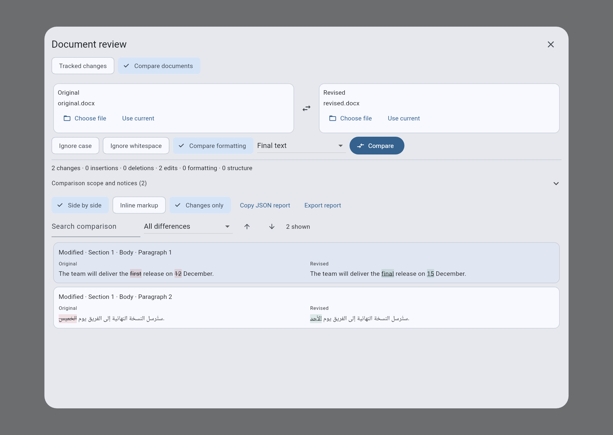

# Document review and comparison

The Word editor checks writing while you edit, offers corrections from marked
text, and keeps a review pane open beside the document. The pane covers writing
findings and pending tracked changes. A separate, read-only workspace compares
two documents without rewriting either input or generating revision spans in
the active file.

## Use the workspace

In Office Studio, open **Review → Spelling** or press **F7** for the Writing pane.
Open **Review → Review changes** for the Changes pane. Both keep the document
editable. The pane sits beside the canvas in wide editors and below it in narrow
editors. **Escape** or its close button returns to the document.

The status bar at the bottom of the shared Word editor shows checking progress
and pending-change counts. Either button opens the corresponding pane, even
when the Review ribbon is not selected. **Review → Compare** still opens the
full two-document comparison workspace. **More review options** in the pane
retains detailed proofing settings and the advanced comparison workspace.

### Check writing while editing

- **Check as you type** is enabled when the shared editor first attaches, unless
  the host or user has already set an explicit preference. Switching documents
  or reattaching an editor does not override an explicit off preference.
- The ordinary configured providers run after a 400 ms pause. The status
  distinguishes waiting, checking, paused checking, incomplete coverage, and
  completed results. An unavailable checker is never reported as a clean check.
- Spelling findings have red underlines, grammar findings blue underlines, and
  writing-style findings amber underlines. Click a marked passage for its
  suggestions, or right-click it for suggestions and the ordinary editing menu.
  Primary-click suggestions preserve document typing focus. They wait for the
  double-click interval so word selection, paragraph selection, and dragging
  retain their normal behavior.
- With the Writing pane open, selecting a marked passage follows that finding
  in the pane. Filter by spelling, grammar, or writing style; navigate between
  findings; choose a replacement; ignore an occurrence, word, or rule; or add a
  spelling to personal words. Document corrections remain undoable.
  Correction and stale-source feedback remains visible above the pane's
  scrolling content.
- Moving the caret, scrolling, and zooming preserve checked results. Editing a
  paragraph removes its old findings immediately while verified findings in
  unchanged paragraphs remain visible and actionable during the typing pause
  and the next check. New findings appear progressively before the entire
  document finishes. Coverage remains incomplete until every checkable
  paragraph and the requested providers have completed.
- Retained findings are rebound to the current document revision. Changes to
  language, provider configuration, story membership, generated content, or
  protection invalidate affected results. Late replies cannot correct a newer
  document. An open suggestion menu stays usable during unrelated check
  progress and closes when its own source becomes invalid.
- **F7** and **Check document** explicitly include configured manual providers.
  Typing, opening the pane, and making a correction do not implicitly run manual
  grammar inference. Repeated requests for the same active explicit check share
  its result, including after partial results appear. F7 also works while a
  review-pane control has focus. **Check document** remains available during an
  ordinary background pass, so you can request manual coverage immediately.
  After editing, run Check document again for fresh manual coverage.
- **Document language** in the Writing pane changes the default language with
  Undo support. Explicit run and paragraph languages remain authoritative;
  each finding displays its actual language. Changing the language schedules
  ordinary checks and does not start optional manual inference.
- **Review ignored findings again** restores ignored occurrences, words, and
  rules while preserving personal dictionary entries. It runs only the
  ordinary configured providers; use Check document for manual coverage.

The available languages and quality of suggestions depend on the configured
providers. The standalone controller supplies the offline German checkers;
Studio also configures its English provider. Optional/native providers retain
their existing installation and availability requirements. The live UI does
not install models, send text to a new service, or apply corrections on its own.

### Review with the keyboard

| Shortcut | Action |
| --- | --- |
| **F7** | Open Writing and explicitly check the document, including configured manual providers. |
| **Alt+F7** | Open Writing and select the next available finding, wrapping at the end. |
| **Alt+Shift+F7** | Select the previous available finding, wrapping at the beginning. |
| **Shift+F10** or the **Menu** key | Open the document context menu at the text caret, including current suggestions and tracked-change actions. |
| **Up / Down**, **Home / End** | Move between enabled commands in a keyboard-opened menu. |
| **Enter** or **numpad Enter** | Apply the highlighted command. |
| **Escape** | Clear a context-menu search, or close the menu when its search is empty; close the review pane when reviewing from the pane. |
| **Tab** in the context menu | Close the menu and return to the document. |

Finding navigation uses the available checked results and does not start manual
inference. From a Writing-pane control, repeated navigation stays in the pane
and respects its category filter. From the document, it navigates all current
findings. An unavailable or incomplete check remains visible in the status.

Keyboard context menus take focus for command selection and return focus to the
document when closed. Pointer-opened inline suggestions continue to preserve
typing focus. Opening a keyboard menu does not move the caret, change a selection,
scroll the document, or create an undo entry. Overlapping findings retain the
explicitly selected finding, and adjacent tracked changes retain the selected
change at their shared boundary. Source changes dismiss an obsolete menu.
Review shortcuts and menu actions cannot operate through a covering modal
dialog. Navigation and context-menu shortcuts do not interrupt an active IME
composition. The caret menu applies to the focused document canvas. Existing
comment bodies use marked-text clicks to reach Writing; reply composers do not
use the document caret menu.

### Keep comment replies inline in Studio

Studio's Comments pane keeps each thread beside the document in a wide window
and below it in a narrower window. **Reply** in the ribbon, on a comment card, or
in a comment's context menu selects the thread and focuses its inline composer.
It never posts a draft just because another Reply command was chosen.

- Each thread has its own draft. Switching threads, hiding and reopening the
  pane, or resizing the window preserves the current document's drafts.
- **Post reply** or **Ctrl+Enter / Command+Enter** explicitly posts the draft to
  its selected thread. Ordinary Enter adds a line break. An active IME
  composition is not submitted.
- Draft typing does not change the document or its undo history. Posting uses
  the normal undoable comment command. A stale action cannot post to a different
  thread or a replacement document, even if a comment ID is reused.
- Drafts for removed threads and replaced documents are discarded. These are
  session drafts; they are not saved into the document before posting.
- The active existing comment body uses the document's live proofing findings.
  Click an underlined passage to select its current finding in the Writing pane,
  where corrections remain undoable. Double-click selection and dragging keep
  their normal behavior. Unposted reply text joins document proofing after it
  is posted.

The shared `QudsWordEditor` retains its Writing and Changes panes. The Comments
pane described here is supplied by Studio's host interface.

### Resolve changes while editing

The Changes pane offers reviewer attribution, **Track text changes**, change
navigation, exact source text and location, and individual **Accept / Reject**
controls with **Undo / Redo**. Clicking a marked tracked change opens it in this
pane. Its context menu also offers accept/reject when the source is valid and
editable. Where a writing finding overlaps a tracked change, the writing
suggestion takes precedence; use its context-menu **Open changes pane** action
to review the change. Read-only mode retains inspection and disables document
mutations.

Expand **Filter changes** in the pane to filter by author, insertion/deletion,
or text. The collapsed section keeps the current decision near the top of the
pane. The count states how many changes are shown and how many remain pending.
**Accept N shown / Reject N shown** applies to exactly that displayed set and is
one undo step. A stale or conflicted member prevents the entire batch.

**Paragraph preview** switches between all markup, final text, and original
text without resolving changes or changing the document. Valid protected text
remains available for read-only previews. Detached or invalid ranges have an
explicit diagnostic and cannot supply a misleading projected preview.

Accepting or rejecting a change selects the next pending change, or the nearest
previous one at the end. Filters keep navigation within the displayed set.
Undo restores the earlier decision and selection; Redo repeats the decision.
Embedded applications can still open the advanced workspace with
`showWordReviewDialog`.

### Review tracked changes

1. Set the reviewer name and turn on **Track text changes** to attribute future
   insertions and deletions. Changing the name does not rewrite existing authors.
2. Filter pending changes by author, insertion/deletion type, and text. The
   counter says how many changes are shown and how many are pending overall.
3. Select a change to see its author, date, exact text, and paragraph preview.
   **All markup text**, **Final text**, and **Original text** change the preview
   without resolving any changes.
4. Accept or reject one change, or use **Accept N shown / Reject N shown** for
   exactly the filtered set. A batch is one undo command. The entire batch is
   validated before any document text changes.
5. Use **Undo / Redo** to revisit a decision. **Show in document** selects the
   exact source span when the canvas supports that story.

Body paragraphs, default headers/footers, and comments support exact canvas
navigation. Notes and first/even headers remain reviewable in the pane when
their source paragraphs cannot be selected in the canvas. Navigation never
redirects an unsupported story to a similarly numbered body paragraph.

Conflicted, stale, overlapping, or detached ranges are shown with a diagnostic;
they cannot be silently accepted or rejected. Resolve or undo the conflicting
edit first. Viewing mode permits inspection and comparison while disabling
document mutation controls.

Tracking continues to cover supported **text insertions and deletions**. It does
not add native formatting-change or structural revision types to the document
model. Comparison can report supported formatting and structure differences
without representing them as tracked edits.

### Compare two documents



Choose the **Original** and **Revised** inputs independently. Either side can use
the current editor document; **Choose file** can select two files without loading
them into the editor. Studio's picker accepts Word `.docx`, `.docm`, `.dotx`, and
`.dotm` packages. A wrong-format or malformed package is rejected instead of
being treated as an empty document. The host API accepts already imported
`WmlDocument` objects, so other host import paths can participate as well.
Studio rejects truncated XML, incorrect document/body namespaces, and duplicate
document or body elements before importing either comparison source.

The default **Final text** comparison omits pending deletions from each input.
The revision-text options are:

| Option | Text compared |
| --- | --- |
| Final text | Retains pending insertions; omits pending deletions |
| Original text | Retains pending deletions; omits pending insertions |
| All markup text | Compares all stored text, including both revision kinds |

Final/original projections fail explicitly if a pending range is invalid or
detached. Markup mode can still inspect stored text and includes a warning.
None of these projections accepts or rejects the inputs' revisions.

**Ignore case** uses Dart's locale-independent `toLowerCase`, not linguistic
collation. **Ignore whitespace** collapses whitespace runs and trims the ends
for matching. Original and revised text remain available in the report even
when those differences are ignored. **Compare formatting** controls modeled
run, paragraph, style, and layout comparisons.

After comparison:

- **Side by side** displays the source texts with deletion/insertion emphasis.
- **Inline markup** shows red strikethrough deletions and green underlined
  insertions. Text is diffed at word/grapheme boundaries without splitting emoji
  or combining sequences.
- **Changes only**, the difference-type filter, and text search narrow the
  results. Previous/next focuses an individual difference; **Show all
  differences** returns to the complete filtered list.
- **Copy JSON report** includes input names, options, complete entry text,
  locations, inline spans, property changes, summary counts, and scope notices.
  Studio also offers **Export report** to save the same report as a JSON file.
- When the active editor document changes through its controller, a comparison
  involving it is marked out of date. Recompare before copying or exporting.

Summary counts count comparison entries, not words or characters. An entry can
be an inserted/deleted/modified paragraph, a formatting change, or a modeled
structural change. Reading the report does not apply a merge or create a new
redline DOCX.

## What is compared

The engine compares body text, table/frame text, TOC title/result paragraphs,
default/first/even headers and footers, footnotes, endnotes, and comments.
Paragraph alignment uses unchanged
anchors, so a paragraph inserted near the beginning does not automatically mark
every later paragraph as changed. Dense unmatched regions may use a complete,
coarser replacement within the configured work budget.

Supported comparisons include modeled run/paragraph formatting, style
definitions, section layout, table/frame geometry, links and field semantics,
bookmarks, comment metadata/anchors, and preserved XML where the model exposes it.
Character formatting positions are compared for unchanged or normalized-equal
text. In rewritten paragraphs, character formatting is summarized by the styles
used; the report does not align every formatting change inside rewritten text.
Preserved XML is compared as source content, not certified semantic equivalence.
Auxiliary stories follow their order in each input; reordered notes/comments or
sections can therefore produce multiple changes rather than a move operation.

This is a modeled-content report, not a rendered-page or complete package diff.
Image pixels, chart/diagram internals, equation internals, embedded payloads,
numbering definitions, document/package settings and metadata, protection,
package themes, and unsupported native constructs have explicit scope limits. Consult
the report's scope notices. A report with no differences means no differences
were found in the compared content under the selected options, not that every
byte or rendered page is identical.

## Engine API

```dart
import 'package:quds_office_engine/quds_office_engine.dart';

final report = WordDocumentComparison.compare(
  original,
  revised,
  options: const WordComparisonOptions(
    includeFormatting: true,
    ignoreCase: false,
    ignoreWhitespace: false,
    revisionView: WordComparisonRevisionView.finalText,
  ),
);

for (final change in report.changes) {
  print('${change.kind.name}: ${change.label}');
  print(change.originalText);
  print(change.revisedText);
}
final json = report.toJsonString();
```

The engine has no Flutter dependency. Result entries, locations, and spans have
no references to the mutable source models. `WordCompare.diff` is a convenience
alias. `WordEditorController.compareWith(original, options: ...)` compares the
given original against the current editor document and returns the same result.
It works in viewing mode and does not change dirty state, history, or the content
revision.

The default per-input limits are 20,000 paragraphs and 4,000,000 UTF-16 units
across text, preserved XML, and comparison metadata. Heavily formatted documents
can reach this bound before their plain text reaches that length.
A shared 2,000,000-cell alignment budget bounds difficult
paragraph/inline matching; model-node and nesting limits also guard malformed
inputs. Exceeding an input limit produces an error with **no partial report**.
Exceeding the alignment work budget preserves the complete text and marks the
result `usedCoarseDiff` with a warning. Hosts can provide explicit positive
limits in `WordComparisonOptions`.

## Host integration

```dart
await showWordReviewDialog(
  context,
  controller: wordController,
  documentName: currentFileName,
  initialTab: WordReviewTab.compare,
  pickDocument: () async {
    // Use the host's picker and supported import pipeline.
    final picked = await pickAndImportWordDocument();
    if (picked == null) return null;
    return WordComparisonDocument(
      document: picked.document,
      name: picked.name,
    );
  },
  onExportReport: (suggestedName, json) async {
    // Return false if the destination picker is cancelled.
    return saveComparisonReport(suggestedName, json);
  },
);
```

The file picker and export callbacks are optional. The shared editor does not
gain filesystem or file-picker dependencies. Native comparison work runs through
Flutter `compute`; web uses its same-isolate implementation with the same bounded
engine. The dialog handles cancelled/erroring picks and late completion after it
has been closed.

Controller review APIs:

```dart
// Persistent review alongside the QudsWordEditor canvas.
wordController.openReviewPane(); // Writing findings.
wordController.openReviewPane(tab: WordReviewPaneTab.changes);
wordController.closeReviewPane();
wordController.proofing.enabled = false; // Remember an explicit off preference.
await wordController.checkDocumentProofing(); // Includes manual providers.

wordController.revisionAuthor = 'Reviewer name';
wordController.setTrackRevisions(true);
wordController.acceptRevisions(selectedPendingChanges); // One undo step.
wordController.rejectRevisions(selectedPendingChanges); // One undo step.
final shownInCanvas = wordController.revealRevision(change);
```

`QudsWordEditor` defaults to `enableLiveProofing: true` and
`showReviewStatus: true`. Hosts with their own chrome may hide the status bar or
leave enabling background checks to their own controls. `WordReviewPane` and
`WordReviewStatusBar` are also exported as standalone host widgets. A standalone
`WordEditorController` does not start a background timer until enabled by a host.

`selectProofingIssue` / `stepProofingIssue` navigate current findings while
keeping unsupported canvas stories reviewable in the pane. An explicit
selection survives a recheck of unchanged source text and is not replaced by a
neighboring finding at the selection endpoint. `refreshView()` is for host
selection/scroll/zoom notifications; `refresh()` still invalidates proofing
after direct model edits that bypass controller commands.

### Migration from the old comparison helper

The old `WordCompare.compare(original, revised)` mutation algorithm could record
deletion text against mismatched revised ranges and overlap it with insertions.
It is deprecated and now throws `UnsupportedError` **before either input is
changed**. Use `WordDocumentComparison.compare` or `WordCompare.diff` for a report.
`WordEditorController.compareWith` now returns the safe read-only result instead
of mutating revisions. Callers that previously ignored its return value should
display the returned report or open the review dialog.

The suite still imports, displays, resolves, and exports supported existing DOCX
insert/delete revisions. Generating a fully faithful structural redline document
from two arbitrary files is a separate capability and is not claimed here.

## Verification

See [the local validation record](validation/document-review-20261118/README.md)
for the reconciled source history, runtime pins, test commands, and results.
The [live-review record](validation/document-review-live-20261118/README.md)
records the first in-editor implementation. The
[incremental review record](validation/document-review-continuation-20261118/README.md)
records retained findings, progressive checks, expanded pane controls, and the
subsequent local regression and interaction checks. The
[keyboard and comment review record](validation/document-review-keyboard-comments-20261118/README.md)
records the subsequent keyboard menus, inline replies, and local verification.
GitHub Actions are not required for the local verification workflow.
