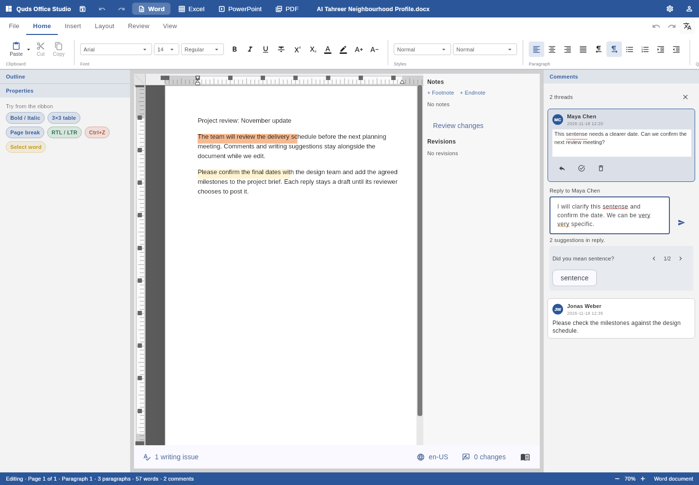
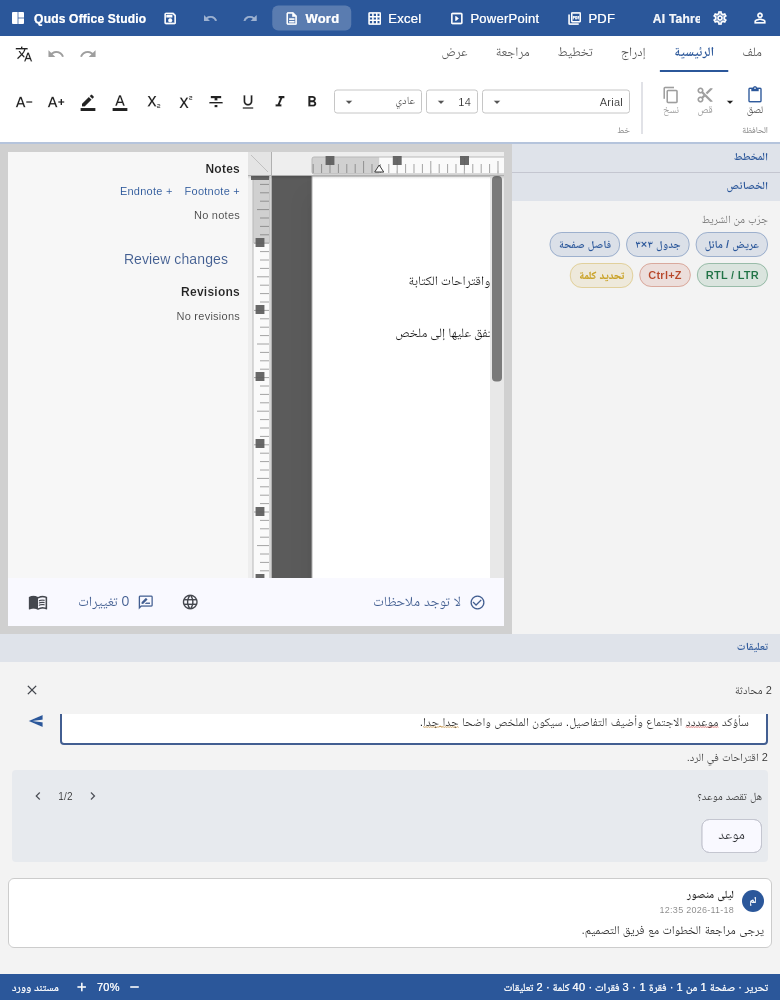
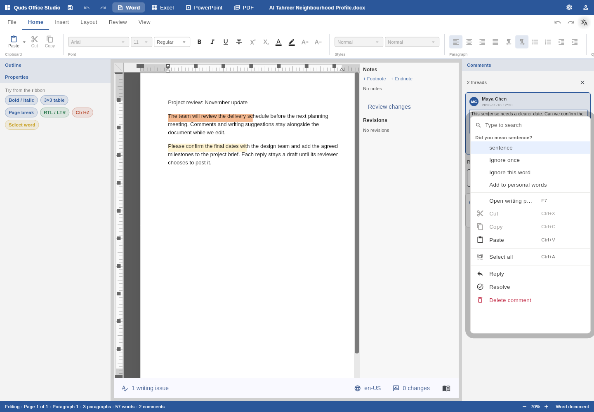

# Live reply checking and keyboard comment review — 18 November 2026

This continuation builds on the existing live Writing/Changes panes, text-level
language controls, marked-text suggestions, and inline comment threads. It makes
unposted replies checkable in place, opens existing comment menus from the
keyboard, and checks the paragraph being edited before the rest of a long
document. All work was saved incrementally to `codex/document-review-20261118`
and remains in PR #162.

## Accepted source and results

The accepted local gate ran against **`66919cf857fe2439a3512a821817f35981760a75`**, tree
**`33faed80ab06c0d5aa3e8b9faa73ceff27892246`**, after the initial and final incoming reconciliations.
Subsequent publication changes contain documentation and evidence only.

| Gate | Result |
| --- | ---: |
| Engine — 6 suites | 95 passed |
| Editor — 41 suites | 692 passed |
| Studio — 8 suites | 94 passed |
| **Targeted regression total** | **881 passed; zero failed/skipped** |
| Strict analysis — 39 changed Dart files | No issues |
| Formatting and authored-source whitespace | Clean |
| Imported enough_mail vendor tree | Exact match to captured incoming tree |
| Source, fixture and configuration binding | 4,946 inputs unchanged |
| Runtime, dependency lock and configuration | 11 bound inputs unchanged |
| Visual verification, counted separately | 3 cases passed; 3 screenshots inspected |

The gate excludes reporter setup/loading/teardown events from case counts and
requires every requested suite to contain completed cases, with no failures,
skips, missing suites, unfinished events, or reporter errors. The three visual
cases are counted separately. This is a targeted local gate, not the complete
repository test suite.

- [Accepted gate receipt](accepted/verification.json), per-case results, and raw
  and compressed reporter logs under [accepted/checks](accepted/checks).
- [Source before](accepted/source-before.json) and
  [source after](accepted/source-after.json) bind every tracked product input in
  `packages/`, `apps/`, and `third_party/`, root configuration, the gate runner,
  and the visual fixture. The frozen HEAD, index, and tracked tree stayed clean.
- [Environment before](accepted/environment-before.json) and
  [environment after](accepted/environment-after.json) bind the dependency lock,
  package configuration, runtime receipts, wrappers, Dart, Flutter tester,
  Flutter tool snapshot, and Flutter tool dependency configuration.
- [Final source binding](final-source-binding.json) compares the published tree
  to the accepted source manifest after evidence assembly.

The whitespace gate checks authored changes. It excludes only the pristine
`third_party/enough_mail` import after verifying that its entire Git tree equals
the captured incoming commit `46d7422d5ac356c327759872ff28adcd154b75ad`. Imported
MIME fixtures contain byte-significant CRLF and whitespace; the vendor tree,
upstream tests, and notices remain unchanged and fully covered by the source
hash manifest. The first full whitespace report is retained in the failed-gate
archive, including the separate authored Mail pubspec EOF issue that was fixed.

## Behavior added in this continuation

### Check a reply before posting

With Check as you type enabled, ordinary configured providers check the reply
after the session's 400 ms pause. Spelling, grammar, and style findings use red,
blue, and amber underlines. The composer shows checking/coverage state, previous
and next finding controls, and focusable replacement buttons. A correction
changes only the captured draft range and returns focus to the reply field.

Draft results use the document language and current personal vocabulary,
ignored words, and ignored rules. They remain separate from document findings
and Undo. Typing and correcting a draft do not dirty the document; explicit
posting remains one undoable comment command. Optional manual providers are
never invoked by draft checks. An unavailable check or a reply language
unsupported by every configured provider is not reported as clean.

Checks wait for IME composition to end, including an end event without a text
change. Late results and captured actions validate document, thread, draft,
source, configuration, and editing context. The session bounds work to one
running draft check and the latest pending request across thread switches.
Replies longer than 16,384 UTF-16 units report the live-check limit and remain
postable; stored comments use the normal document checker.

### Open an existing comment menu with the keyboard

Shift+F10 or Menu opens the menu at the actual comment caret. The host receives
the new optional `QudsWordEditor.onCommentContextMenuRequested` callback, resolves
the current comment canvas, and retains explicitly selected overlapping-finding
identity. Arrows, Home/End, and Enter operate enabled commands; Escape or Tab
returns focus when the captured context is still valid. Select mode supports
Copy without enabling edits. View mode leaves Studio comment canvases
noninteractive. Document viewing/protection continues to allow keyboard
inspection, with correction disabled.

### Publish the active paragraph first

The proofing session's optional priority callback checks the active body,
existing comment, header/footer, or Notes paragraph first. Findings for that
paragraph publish as soon as its check finishes, including in the 101-paragraph regression case
with an earlier paragraph held by a slow provider. Navigation remains in document
order, unaffected paragraphs retain cached findings, and caret movement does not
restart the current pass. Reading the priority target never creates an empty
header/footer, comment, or note story.

### Keep narrow and scaled layouts usable

The Arabic draft interaction test uses 650 × 1000 logical pixels at 1.4× text
scale. It exposed Studio header and ribbon overflow, so title commands and tabs
now scroll while trailing controls remain reachable. Header/ribbon heights use
the actual scaled text metrics. The document title keeps native window drag
and double-click maximize wiring. The test retains its original narrow/large
text conditions and performs an actual pointer correction without overflow.

## Coverage and screenshots

The new suites contain 19 draft-session cases, 15 Studio draft cases, 9 Studio
comment-keyboard cases, and 7 priority cases. They cover coalescing, stale
document/thread/configuration identities, IME completion, manual-provider
exclusion, paused/incomplete/over-limit states, ownership of services, focus,
explicit posting/Undo, cached document-order navigation, actual caret geometry,
read-only Copy, modal blocking, and narrow Arabic interaction. Existing review,
language inheritance, DOCX, Zotero Notes, thesaurus, revision, input ownership,
and Studio regressions run alongside them.

The separate [visual receipt](visuals/verification.json) records three passing
interaction fixtures and exact screenshot hashes. The primary agent inspected
all three complete images; [inspection notes](visuals/inspection.json) record
their scope. The 780px Arabic screenshot is separate from the stronger 650px,
1.4× text-scale behavioral case.

| Draft checks beside the document | Narrow Arabic reply | Keyboard comment menu |
| --- | --- | --- |
|  |  |  |

## Incoming reconciliation

Reconciliation preceded application edits. The initial inventory captured 210
fork branches, 170 PR heads, and four upstream branches. Four actual three-way
merges brought in Zotero Notes, thesaurus, spaCy EN/FR, and Mailcore changes,
reaching `39eada31155dd85d971bab71d26cda6e67cb6844` before feature work.

One later bounded observation at **2026-11-18 19:23:15 UTC** captured 210 fork
branches, 171 PR heads, and four upstream branches: **385 references to 251
unique heads**. Four further three-way merges included Mail through
`46d7422d5ac356c327759872ff28adcd154b75ad`, thesaurus qualification through
`0e84dc951e7a9e923107d7895fa457cf29a7af71`, Zotero Notes qualification through
`c93fc23b388a053f0b4742b771adb511aaf3578a`, and spaCy publication evidence through
`637b67c58482e40a3244c590ce77c08b9fc2740e`. The final four merged cleanly.

All captured references are accounted for: **357 references / 237 unique heads
through ancestry**, plus **28 references / 14 verified historical-equivalent
heads**. No captured head remains unresolved. The historical checks use Git
patch equivalence, identical trees with ancestry, or exact preserved-file
comparisons as appropriate; they do not claim those 14 heads are ancestors.

[Initial inventory](incoming-inventory.json) · [Final classified frontier](final-frontier.json)
· [Historical equivalence](historical-equivalence.json) · [Merge and conflict record](reconciliation.json)

The cutoff is deliberately finite so concurrent branches cannot indefinitely
move the target during verification. Imported evidence may mention earlier CI
runs; this continuation did not query, wait for, or use GitHub Actions status as
an acceptance gate.

## Runtime and reproduction

The runtime is the recorded **Flutter 3.47.8 / Dart 3.13.7**. Its official SDK
archive and Dart/Flutter tester executable hashes were verified. The final
workspace resolves 121 packages with 168 verified hosted archives. The late
Mail merge added six hosted dependencies and one path dependency, with existing
pins unchanged. Offline resolution and offline `--enforce-lockfile` both passed.

Final workspace lock SHA-256:

```text
43261dbd4acce9c423c8f19f5c86841a9f05aff3b3b968c94a7b48f94c9f8239
```

The [runtime evidence](runtime/) includes original/final lock provenance,
archive and cache receipts, and restoration instructions. Restore that runtime
and its locked dependencies, check out the accepted source, and run:

```bash
python3 docs/validation/document-review-drafts-20261118/run_checks.py \
  --head 66919cf857fe2439a3512a821817f35981760a75 \
  --base 39eada31155dd85d971bab71d26cda6e67cb6844 \
  --runtime ../toolchains \
  --output ../review-drafts-reproduction
```

Run one Dart/Flutter verification process at a time on a memory-limited host;
the runner sets test concurrency to one. It requires a clean frozen source,
does not install dependencies, and writes outside the checkout. The visual
fixture is [render_comments.dart](render_comments.dart); its separate recorded
runner copies it temporarily into the example test directory, renders the
three cases, and removes that temporary file.

## Development failures and publication

[Development attempts](attempts/) preserve interrupted, failing, and corrected
development checks separately. In particular, the first integrated gate on
`bfa88aab88a74028285619dfa07f3a81868fe59b` exposed the new selection guard blocking
keyboard inspection in viewing/protected documents. The fix scopes that guard
to the comment callback; both original inspection assertions remain intact.
The same attempt recorded seven strict-analysis infos and one formatting
discrepancy. These were corrected, including the incoming Mail fixture's
development dependency on its existing workspace example. Offline lock
enforcement, package configuration, and runtime receipt identities remained
unchanged. The subsequent preflight is recorded separately and is not added
to the accepted count.
Development attempts are excluded from the accepted totals above.

[Publication receipts](publication.json) record incremental saves, expected
prior heads, merge parents, and verified tree identities. Updates did not
force-push and commit messages include `[skip ci]`. **No GitHub Actions status
was queried or awaited.**

## Limits

These checks use controlled providers and local engine/controller/widget,
rendering, interaction, and DOCX workflows. They do not establish full native
builds, physical OS shortcut delivery, real platform IME behavior, native window
dragging, a live Mail account, or live optional-model/Zotero service behavior.
Priority cases establish ordering and progressive publication, not a measured
real-world latency improvement. Drafts remain session-local until posted.
Existing tracked changes remain supported text insertions/deletions, and
comparison remains a read-only report.
