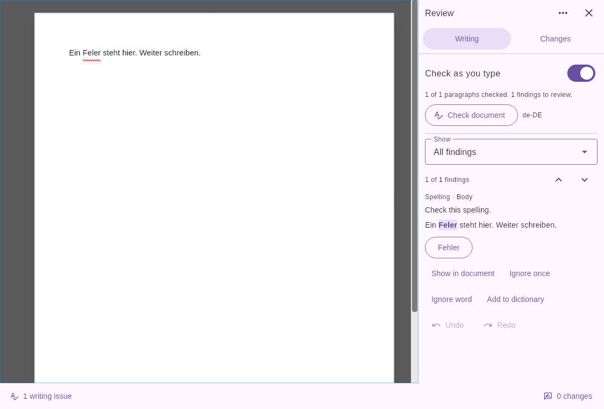
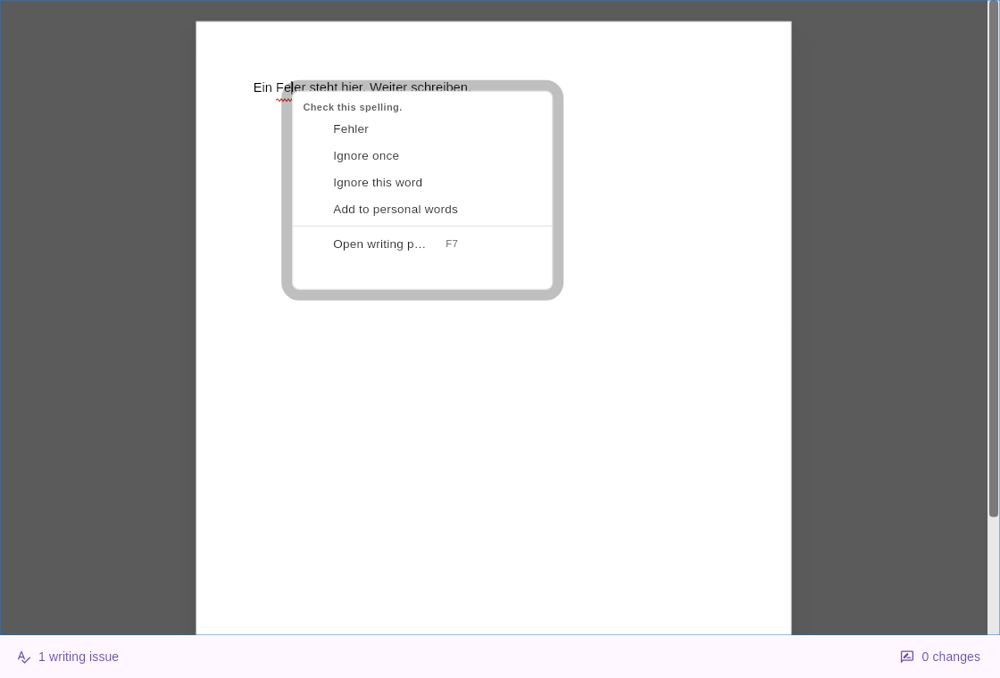

# Live document review — 18 November 2026

The shared Word editor now checks writing during editing and keeps Writing and
Changes panes open alongside the document. This continues the earlier tracked
change and two-document comparison work on `codex/document-review-20261118`.

## Delivered interaction

- Background checking starts after a 400 ms typing pause. An explicit off
  preference survives reattachment and switching Studio applications.
- A persistent status bar distinguishes waiting, checking, paused, incomplete,
  and completed checks, with a separate pending-change count.
- Marked text offers inline suggestions. Primary clicks leave input focus with
  the document; double/triple clicks and drag selection retain their behavior.
- Writing and Changes panes sit beside a wide canvas and below a narrow one.
  The document remains available for editing, and Escape closes review even
  when a pane control owns focus.
- Writing review includes category filters, finding navigation, exact source
  context, corrections, personal words, and occurrence/word/rule ignores.
- Changes review includes attribution, tracking, navigation, source text,
  accept/reject, and undo/redo. Advanced filtering, batch resolution, settings,
  and comparison remain available through the existing dialogs.
- Source edits immediately invalidate old findings and suggestion menus.
  Selection, scrolling, and zooming no longer invalidate unchanged checks.
- Explicit review selections survive supported rechecks, including findings in
  notes/alternate headers and adjacent ranges sharing an endpoint.
- F7 and Check document include manual providers. Typing, opening the pane and
  correcting an issue use ordinary providers only. Identical active explicit
  checks share their future; changed text/configuration can start a new pass.

See [the usage and embedding guide](../../document-review.md).

## Current local verification

The final product checks ran on source commit
`bfd3df1596dd77d10d68f7909d5a3da2166135c4` with Flutter **3.47.8** and Dart
**3.13.7**. **254 targeted tests passed, zero failed and zero skipped.**

| Gate | Result | Evidence |
| --- | ---: | --- |
| 17 editor suites | 241 passed | [JSON events](checks/editor.jsonl), [individual cases](checks/editor-cases.json) |
| 3 Studio suites | 13 passed | [JSON events](checks/studio.jsonl), [individual cases](checks/studio-cases.json) |
| Strict analysis of 31 changed Dart files | No issues | [Analysis log](checks/analysis.log) |
| Formatting of the same files | No changes | [Format log](checks/format.log) |
| Whitespace check from the previous review head | Clean | [Whitespace log](checks/whitespace.log) |

The selected suites include **46 new regression cases** across live sessions,
selection/single-flight checking, shared surfaces, panes and Studio. Existing
editor gestures, input ownership, proofing geometry/navigation/dialogs, revision
stories, comparison and newly integrated Zotero detail workflows are also
covered. Hidden loading/setup events are excluded from test counts.

All **599 recorded source, manifest, bundled-font and selected test files** were
unchanged before/after execution and matched the committed source. The final
native-spelling preservation merge at
`5137304cbb577094352bd33701397d93190615a6` changes only validation evidence.
The delivery records introduce no subsequent application/test/manifest changes.

- [Machine-readable verification](verification.json)
- [Source SHA-256 manifest](source-sha256.json)
- [Delivery source binding](delivery-source-binding.json)
- [Runtime, executable and dependency-lock pins](runtime.json)
- [Repeatable local runner](run_checks.py)

Activate a matching Flutter runtime and the pinned dependency cache, then run:

```bash
python docs/validation/document-review-live-20261118/run_checks.py
```

The runner uses `flutter test --no-pub`, strict Dart analysis and format checks.
It sets `CI=true` to select the SDK's local CI startup path, and suppresses
analytics. It never queries or waits for GitHub Actions. The restored runtime's
25 setup smoke checks and earlier development runs are not added to the final
254-test total. The runner's final tree lookup was subsequently tightened to
resolve the captured source SHA; this documentation-tool change does not alter
the tested product or the recorded successful run.

## Visual inspection

These images render the actual shared editor/pane widgets with bundled text
fonts and the pinned SDK's Material icons. Deterministic fixture providers make
the interaction repeatable; the images are not dictionary-quality evaluations.
Desktop and 320 × 480 English/Arabic surfaces at 1.5× text scaling were checked
for visible document space, readable controls, correction access and overflow.





[Narrow English](screenshots/live-review-english-narrow.png) ·
[Narrow Arabic](screenshots/live-review-arabic-narrow.png)

The source test can reproduce them with `QUDS_REVIEW_SCREENSHOT_DIR` set:

```bash
flutter test --no-pub test/word_live_review_surface_test.dart
```

## Incoming work and remote preservation

The initial inventory reconciled **203 fork branches, 164 PR heads and four
upstream branches** before implementation. A clean fast-forward to `fb1fd4dc`
brought in PR #164's Zotero continuation and the native-spelling fixes.

The later inventory contains **204 fork branches, 165 PR heads and four upstream
branches**. PR #165's stored-reference review was integrated with both histories
preserved. The shared changelog retained both sets of additions; a trailing
blank line in incoming validation prose was normalized. The final independent
native-spelling advance was evidence-only and was preserved after testing.

The previously superseded branch/PR heads were rechecked by ancestry, patch,
whole-tree or documented changed-file equivalence, rather than merging obsolete
alternatives over the consolidated source. Main at `f383c826` is included.

- [Initial full inventory and disposition](incoming-audit.json)
- [PR #165 recheck](incoming-recheck.json)
- [Final observed frontier and evidence-only preservation](final-frontier.json)
- [Incremental checkpoint record](publication.json)

| Remote checkpoint | Purpose |
| --- | --- |
| `e9dc9279` | Full incoming reconciliation audit |
| `f96162eb` | Live defaults, status, persistent panes and canvas entry points |
| `fb7a06eb` | Typing focus, gestures, stale/adjacent/story selections and regressions |
| `32aa7b45` | Merge PR #165's stored Zotero reference details |
| `bfd3df15` | Completed source and reproducible local checks; final tested revision |
| `5137304c` | Preserve late native-spelling evidence without source changes |

Each checkpoint used an expected-head, non-forced GitHub ref update and a remote
tree matching the staged local tree. Commit messages include `[skip ci]`.
No Actions status was queried, awaited or treated as a completion gate.

## Scope

The delivered controls use configured proofing providers. Optional engines keep
their installation, language support and manual/background boundaries. This
work does not install optional engines, add new remote inference, automatically
apply corrections, or broaden revision tracking beyond supported text
insertions/deletions. The existing comparison remains a read-only report.

Verification covers local Flutter widget/interaction behavior and strict source
checks. It does not claim full native application builds, native macOS UI
execution, live optional-model inference or a complete repository test run.
