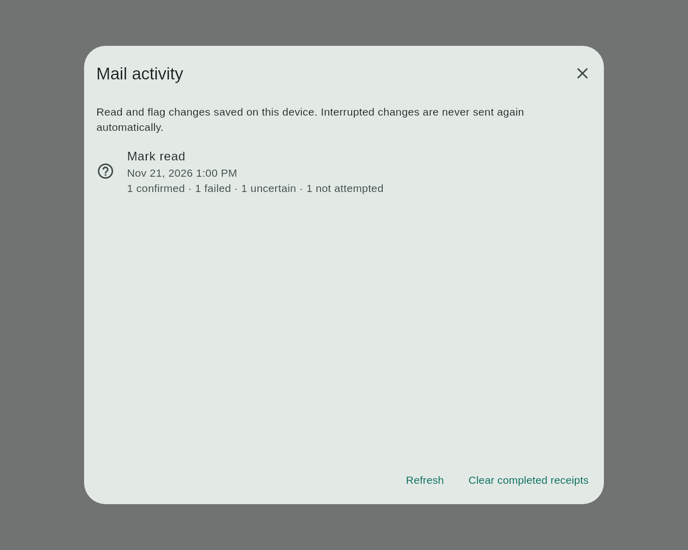

# Mail command journal: integration and local qualification

This increment adds durable foreground read/unread and flag/unflag commands to
native Studio Mail, with account-scoped activity history and conservative crash
recovery. It also reconciles the captured incoming Mail, Word, Zotero, layout and
maintenance work. The product contract and ordered continuation are in
[the command-journal roadmap](../../roadmaps/mail/command-journal.md).

The qualified source and test publication is
`19eccc016fd14bea52c095db917a28b5ce3cdd5c`, tree
`39e5a1911a06c3a6888ed465d6dea9df06ff6b42`. Later commits containing this report
and evidence do not alter runtime or test inputs. The delivery branch is
`work/mail-command-journal-20261121` and the integration PR is
[#279](https://github.com/CrispStrobe/quds_office_suite/pull/279).

All acceptance below was executed locally. GitHub Actions, workflow runs,
statuses and checks were neither queried nor awaited.

## What changed

- Single-message and checked-message flag controls for IMAP, Exchange EWS,
  Gmail and Microsoft 365 share a journal. The complete intent and each applying
  marker commit before the corresponding provider call. Persistence failure
  prevents or stops later dispatch.
- Schema v6 saves immutable subjects, stable account/message identities,
  desired states and per-message outcomes. A confirmed result and its exact
  cached-flag update commit together. The cache revision fence also advances
  when the requested bit already matches or the full flag snapshot is unknown.
- Reopening or logging out preserves confirmations, turns unfinished applying
  markers into Uncertain results and leaves the untouched tail Not attempted.
  Recovery makes no provider calls. A retiring view cannot publish stale UI,
  while its original owner can still persist a late acknowledgement.
- **Mail activity** is available from connected and cached mail. It provides
  paginated history, frozen message receipts and confirmed cleanup of completed
  history. English, German and Arabic captures cover desktop and compact
  layouts. Running and uncertain work is retained.
- Incoming reader improvements remain integrated: meaningful inline spacing,
  explicit bounded image loading, image retention, cancellation and stale
  reader/account protection. Saved-account autoconnect and ribbon controls
  retain their newer identity and callback guards.
- Cloud flag HTTP 410 responses remain uncertain after dispatch rather than
  being certified as a proven rejection. The existing send rejection policy is
  separate and unchanged.

## Complete incoming-source reconciliation

The final complete API snapshot finished at **2026-11-20 23:32:20 UTC**.
The [exact snapshot](final-remote-refs.json) and
[recomputed inclusion proof](final-intake.json) contain every page and head.
The [final reconciliation report](final-intake.md) and
[retention audit](final-intake-retention.json) also verify the incoming evidence
and the retained Word implementation directly.

| Source | Captured heads | Direct ancestors | Proven equivalents |
| --- | ---: | ---: | ---: |
| Fork branches | 40 | 30 | 10 |
| Fork PR heads | 279 | 265 | 14 |
| Upstream branches | 4 | 4 | 0 |
| Upstream PR heads | 4 | 4 | 0 |
| **Total** | **327** | **303** | **24** |

There are zero uncovered heads and zero unavailable Git objects. Sixteen
equivalence proofs are recomputed from immutable objects; an old alternative
implementation is not reapplied over a newer integrated implementation merely
to make its branch an ancestor. The initial reconciliation and detailed union
decisions remain in [intake.md](intake.md).

Later captured work includes main `329d` and `383c0c0c` (the merged PR #277),
the newer PR #277 reader/session guards, and PR #278's sequence through
`4163368b`, `58cc4283` and `0e4e999a`. The last two incoming commits after
`58cc4283` contain only Mail/Word evidence and a qualification-link update.
Their documents are preserved alongside this milestone's newly executed
acceptance. The final snapshot is an explicit cutoff for concurrently active
branches; the main branch is checked separately at publication.

## Accepted local gates

Every accepted run has an observed process exit of zero, one successful
terminal test event, raw event logs, exact case accounting and unchanged
before/after input manifests. The source applicability reports identify later
focused coverage instead of describing older full runs as rerun results.

| Gate | Passing cases/executions | Scope and accounting |
| --- | ---: | --- |
| Mail core, Dart VM | 235 | Complete core suite, including 16 journal cases. |
| Mail core, Node | 235 | The same 235 cases on JavaScript; not 235 additional unique cases. |
| Mail store, native SQLite | 749 | Complete store suite, including 26 journal, 14 actual SIGKILL and 15 migration cases. |
| Mail UI | 200 | Complete UI suite; no skips. |
| Studio Mail host aggregate | 505 | Sixteen suites, including 35 new real-SQLite adapter/history/native/EWS/cloud host tests. |
| Final affected host suites | 176 | Six-suite follow-up for the late incoming fixture union; overlaps the host aggregate. |
| Cloud mutation provider | 105 | Includes the retained HTTP 410 regression and unchanged send-policy cases. |
| Office engine, Dart VM | 836 | Complete incoming acceptance entrypoint after the numeric-preference correction. |
| Office engine, Node | 819 | Exactly the portable subset; all 17 filesystem-only cases passed on the VM. |
| Office editor | 598 | 578 aggregate plus 20 additional original reference-DOCX cases, with no overlap between these two groups. Eight existing picture-only cases explicitly skip editing because they have no paragraphs. |
| Office visual comparisons | 17 | Seven suites, 26 live Linux image references, exact comparator, no update-goldens flag. |

These rows are deliberately **not summed**: platform reruns, focused follow-ups
and related aggregates overlap. None of the earlier diagnostic successes is
added to the final accepted counts.

The runtime is Flutter 3.47.8 at
`737ba8f885dc774b53b442759999a312c9461e4e`, Dart 3.13.7 and Node 24.22.3 on Linux,
with locked offline dependencies and the actual native SQLite library. The
example's new Drift development dependency uses the already resolved workspace
version; the lockfile and package-resolution configuration are byte-identical.

### Source applicability

[source-applicability.json](source-applicability.json) compares the recorded
source closures with the immutable qualified publication. Core/store retain
all 115 final package-file hashes. The engine run differs only in unrelated
example development-dependency metadata; its original runner bytes are retained.
The UI and final provider inputs match exactly. The 505-case host run precedes
the provider classification and late fixture changes; the 105-case provider
and 176-case host gates cover those exact final bytes. This is an explicit
continuity argument, not a claim that the full host aggregate ran a second time.

The [Office qualification](office-qualification.md) separately binds its source
and fixture inputs. It documents the sole later provider-source bridge for the
main editor run and the exact current-source golden/reference-document gates.

### Visual evidence

[visual-review.json](visual-review.json) indexes nine inspected captures:
English desktop and German/Arabic compact history, receipt and details views.
Compact captures use 1.4x text scale. Text remains readable, close controls are
reachable and no overflow was observed. These deterministic widget captures do
not claim every device configuration; fixture date formatting follows its
Material/device locale.



## Corrections and retained failed evidence

The archives retain unsuccessful attempts separately from accepted runs:

- A cache race initially allowed an older writer to overwrite an already-equal
  confirmed flag. The corrected revision fence passes both stale-writer cases
  and the full 749-case store gate, including crash-boundary assertions.
- A host retirement regression initially lost a late provider acknowledgement.
  Shared owner lifetime and account/view guards now retain the durable receipt
  without publishing into a replacement account or reader.
- The incoming cloud regression initially exposed the HTTP 410 classification
  mismatch. Its 103-pass/two-failure run remains a diagnostic; the corrected
  105-case run is the accepted provider gate.
- The first late host attempt stopped after 125 cases at an unnecessary awaited
  stream close in a cancelled fake-async fixture. It has an explicit interrupted,
  unaccepted receipt. Removing that cleanup await preserves the cancellation
  assertions; the second complete 176-case run passed.
- Earlier wrapper failures parsing generated native-asset YAML have no inferred
  process exit. Those logs are diagnostics; accepted runs were repeated with
  the corrected parser and observed exits.
- The first Node engine aggregate exposed integral JSON-number interpretation
  and unsupported filesystem calls. Strict numeric normalization now accepts
  only finite enum values 0/1/2, with VM/JavaScript regressions. The exact 17
  filesystem cases remain in the VM gate and are explicitly excluded on Node.
- Incoming visual references predated main's intentional cell-padding change.
  Isolated same-runtime experiments proved the cause. The intended 4.25-point
  padding remains; thirteen changed scenes were reviewed, thirteen references
  remain unchanged, and the obsolete fourth tall-table page was retired only
  after complete token/glyph and repeated native-save checks passed. An explicit
  fixture heading style fixes the previously inconsistent nested scene.

## Evidence files and independent verification

| Evidence | Contents |
| --- | --- |
| [journal-evidence.tar.xz](journal-evidence.tar.xz) and [index](journal-evidence-index.json) | Core/store logs, commands, crashes, migrations, static checks, source hashes and diagnostics. |
| [mail-engine-evidence.tar.xz](mail-engine-evidence.tar.xz) and [index](mail-engine-evidence-index.json) | Final Mail/engine logs, late host attempts, exact runners, earlier diagnostics and incremental publication records. |
| [office-qualification-evidence.tar.xz](office-qualification-evidence.tar.xz) and [report](office-qualification.json) | Golden/editor/reference-document gates, inspected scenes, isolated experiments, source hashes and provider continuity evidence. |

From the repository root, these commands verify saved evidence and current
source hashes without running tests or contacting GitHub:

```sh
python3 docs/validation/mail-command-journal-20261121/verify_journal_evidence.py --repo .
python3 docs/validation/mail-command-journal-20261121/verify_mail_engine_evidence.py
python3 docs/validation/mail-command-journal-20261121/verify_office_qualification.py --repo .
python3 docs/validation/mail-command-journal-20261121/verify_source_applicability.py --repo .
python3 docs/validation/mail-command-journal-20261121/verify_final_intake_retention.py --repo .
```

The source-intake verifier can reproduce the frozen inventory proof against the
qualified commit or a later descendant such as merged main, writing its result
to a separate output directory:

```sh
python3 docs/validation/mail-command-journal-20261121/verify_intake.py \
  --repo . \
  --snapshot docs/validation/mail-command-journal-20261121/final-remote-refs.json \
  --target HEAD \
  --artifact-prefix final- \
  --output-dir /absolute/path/to/intake-replay
```

The archives retain exact runtime commands and runner sources for reproduction.
All Git publications use a non-forced expected-parent ref update and verify the
complete remote tree before aligning the local branch. Earlier accepted source
checkpoints remain in branch history; adding the evidence is another checkpoint.

## Remaining parity work and boundaries

This milestone establishes durable foreground flags and inspectable recovery
evidence. It does not complete Outlook, Thunderbird or eM Client parity.

1. Explicit provider-observation reconciliation for historical uncertainty,
   followed by repository-driven account/folder sessions and reconnect handling.
2. Indexed account-wide and unified search, saved views and conversations with
   visible completeness and source identities.
3. Durable archive/move/delete commands, then rules and quick actions with
   destination checks, previews and recovery.
4. Rich authoring, signatures/templates and Office attachment workflows;
   scheduling, Sent reconciliation, Calendar/People and shared mailboxes need
   their own provider and installed-platform acceptance.

The journal intentionally exposes no automatic replay or uncertainty-resolution
API. One hundred unresolved batches currently block new journaled flag commands;
the next recovery increment must provide an explicit way to resolve that state.
Normal cleanup retains the newest 100 clean receipts within a 200-batch total
bound and never discards unresolved evidence. Cached mail remains read-only.

Provider responses in this qualification are deterministic fixtures. No real
message was sent and no live account interoperability is claimed. Linux SQLite
and SIGKILL tests cover the tested process boundaries, not every device's
power-loss behavior. Node execution does not qualify browser persistence, and
these results do not qualify installed macOS, Windows or mobile behavior.
