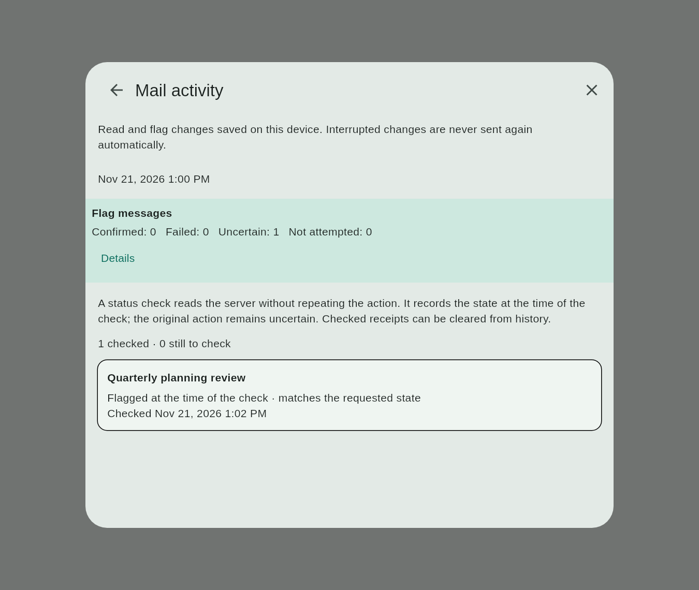

# Mail uncertain-action recovery — 21 November 2026

## Delivered boundary

Native Studio now provides **Mail activity → Check current status** for saved
uncertain read/unread and flag/unflag actions. IMAP, EWS, Gmail and Graph read
the exact historical message identity. The app saves a dated observation beside
the unchanged original receipt, atomically updates only the requested cached
flag, and rejects stale owners, leases, revisions and concurrent profile writes.
It never replays the command. Completed, fully checked receipts release the
unresolved-batch allowance and become eligible for bounded cleanup.

The [recovery guide](../../roadmaps/mail/flag-recovery.md) describes the user path,
provider requests, schema-v7 migration, lifetime fences and remaining scope.
The [ordered roadmap](../../roadmaps/mail/README.md#desktop-mail-parity-ordered-increments)
continues with repository-driven sessions, account-wide/unified search and
conversations, then broader durable commands and rules.

## Incoming work and source checkpoints

The initial audit inspected all 40 fork branches, 280 fork PR heads and four
upstream branches. Of the fork branches, 29 were ancestors, ten had independently
verified historical equivalence, and one contained new additive work. Of the
PR heads, 266 were ancestors and 14 had verified historical equivalence. All
four upstream heads were ancestors. Counts include the newly created work
branch; equivalent refs overlap and are not extra independent features.

The only new initial head, `bbccae1bdead10951e2d7a23b33cf14c55382e02`, carried
28 Word/Mail validation evidence files and a reader API compatibility alias.
The integration retained newer foreground-journal and remote-image safeguards,
restored the exact evidence blobs, and added the missing `remoteImageUris`
alias/assertions. An earlier alternative merge contained superseded source
resolutions and was not allowed to replace current behavior. See
[intake-snapshot.json](intake-snapshot.json) and [intake-review.json](intake-review.json)
for exact refs and independently recomputed equivalence proofs.

Every checkpoint below was saved to GitHub branch `work/mail-parity-20261121`
using a non-forced, expected-head update. Remote tree hashes were compared with
the local staged tree before advancing the branch.

| Commit | Saved increment |
| --- | --- |
| `d6e8fddd08755fe84e82f2a7a0bce200f0c92826` | Reconciled initial incoming work and retained exact Word/Mail evidence; parents include current main and the new incoming head. |
| `71a9d73f86a30380d7fe3563f1a0048f1f7eb860` | Optional portable observation port, strict read-only IMAP/EWS/Gmail/Graph observations and provider tests. |
| `1df5e678906ff1def11deed085586dc733030595` | Schema v7, immutable resolution evidence, atomic flag/cache updates, concurrency fences, migration and recovery tests. |
| `c25a6ffb1b74673b567cc91eaba0d9d3a2a74345` | Connected Studio recovery flow, cached evidence display, English/German/Arabic controls and adapter/dialog/host/loader tests. |
| `339663d4e9c4832ac44ef7fcf2d6146d48ca0e55` | Updated recovery documentation and the ordered parity roadmap. |
| `09500e4452fb01a935dbfa447e2bb8acf829fdd2` | Preserved newly arrived Word PageSetup work and its intake ancestry. |
| `ac2b65cdbdea6d5ca3464c6a1fc826cfccc9e1dc` | Preserved newly arrived Zotero multiparagraph work. |
| `a813d08957695c85b743d82d820ff99567322ff3` | Integrated newer remote main `3d018159`, including Word namespace fix `72aa0ed9` and its existing acceptance evidence. |
| `4be08cb608b6dd1d39bf60bd58a3d17e7563fd8f` | Normalized four incoming Dart files with the pinned formatter. |
| `34bbc6110738761c69070bd2b0714b229709a6b6` | Corrected the existing section-fidelity fixture to select Word XML names explicitly, preserving every expected value. |

A subsequent [remote refresh](final-intake-refresh.json) found two new branches:
Word `770c7dc8` and Zotero `6ac854de`. Both were merged with their ancestry and
evidence. Remote main then advanced through PR #281 to `3d018159`; that newer
main was also merged before publication. The
[source applicability record](final-source-applicability.json) distinguishes
actual ancestors, historical equivalents, unchanged Mail source, integrated
Word fixes and formatter-only differences. Inherited test counts in incoming
evidence remain historical; they are not added to this run's accepted counts.

## Executed local qualification

The genuine runtime is Flutter **3.47.8**, Dart **3.13.7**, Node **24.22.3** and
native Linux SQLite. The SDK archive and 202 hosted package archives were
SHA-256 verified. Workspace dependency resolution used the existing lockfile;
no dependency versions changed. Qualification uses real Flutter execution and
SQLite, with controlled protocol/provider fixtures. GitHub Actions were neither
queried nor awaited.

The accepted feature cohorts include:

| Cohort | Passing cases | What it establishes |
| --- | ---: | --- |
| Full native store inventory, 32 test files | 791 | Reconciliation plus drafts, Outbox, archives, mailbox views, quotas, journal, v1–v6 migrations, corruption rejection and actual SIGKILL transaction recovery. The earlier 154-case focused cohort overlaps this run. |
| Node-only store problem classification | 3 | Browser-related error classification, without a browser persistence claim. |
| Full portable core inventory, 13 test files | 235 VM + 235 Node | Existing providers remain compatible; bulk journal, compatibility aliases, cancellation, identities, search, Outbox and synchronization contracts remain portable. These are 470 executions of the same 235 cases. |
| IMAP observation, EWS provider/SOAP, Gmail/Graph provider tests | 186 | Strict fresh metadata, exact identities, explicit missing/generation outcomes, bounded response parsing, failures and cancellation. |
| Node provider stubs | 6 | Portable imports and explicit unsupported observation results. |
| Studio recovery adapter and dialog | 38 | All provider identity bindings, original outcome retention, explicit checks, cancellation, failure/retry, concurrent checks, offline history and compact localized layouts. |
| Actual connected hosts and native loader | 135 | All four host routes, exact history outside current folder, no write/body/send work, persistent observations, refresh requirement, close/retirement and late-result fencing. |
| Final combined Studio, nine suites | 266 | All earlier Studio recovery cases plus existing journal/bulk/provider/image regressions on main-integrated source `4be08cb6`. Overlaps the preceding 38- and 135-case cohorts. |
| Shared Mail UI, three suites | 21 | Incoming presentation aliases plus explicit remote-image and reader-update guards. |
| Incoming Zotero, focused engine/editor regressions | 309 | Multiparagraph insertion and existing research-target/add-note consumers on `ac2b65cd`; later feature source is identical, with one indentation-only test normalization. Shared Word source changes are listed separately in the applicability record. |
| Incoming Word, five final focused suites | 154 | PageSetup native/compiler/CLI integration, section fidelity and clone behavior on `34bbc611`, including both corrected incoming failure cases. |

Counts are per cohort and must not be summed with overlapping broader regression
runs. Each accepted run has exit zero and a successful terminal event; source
and runtime hashes were unchanged during the source-bound feature runs. The
final evidence index records exact commands, test inventories, raw logs and
before/after manifests.

Six visual captures show English desktop plus German/Arabic compact check and
observed states. Compact fixtures use 360 logical pixels and 1.4 text scale;
close controls remain reachable and content scrolls. Fixture dates follow the
existing Material/device locale and are English. Review found no clipping or
lost recovery controls.

Fatal-info analysis passed for the complete core/store/transport packages and
all eight changed/new Studio library files. Full-store source/runtime manifests
contain 1,086 inputs; core and transport include their resolved dependency and
runtime closure. The final evidence index retains the exact manifest scope for
each gate.

Final formatter and fatal-info analysis checked all 53 changed Dart files at
`4be08cb6`, with zero formatter changes and no analysis issues. The subsequently
corrected fidelity fixture was formatted and analyzed separately with the same
result. Final Studio/shared-UI runs retained 1,173 unchanged source/config/test/
font inputs; final analysis retained 2,419 unchanged source/config inputs.

### Incoming Word failures resolved before acceptance

The first combined Word run passed 152 of 154 cases. Repeated PageSetup writes
could append duplicate `xmlns` declarations; independent strict XML parsing
confirmed malformed output. The newer main commit `72aa0ed9` uses exact
qualified declaration matching and is preserved unchanged by this integration.
After that fix, six emitted XML documents parsed strictly, width remained
12,240 twips / 612 points, and 51 repeated writes retained a single declaration,
unchanged source bytes and the expected foreign metadata.

One existing fixture still used an unqualified `getAttribute('w')`, selecting
`xmlns:w` instead of the numeric Word width. Its intermediate run passed 153 of
154 cases. Commit `34bbc611` qualifies both the element and attribute lookup;
all expected values remain intact. The final five-suite run passed all 154
cases. The actual BAS JavaScript compile/Node smoke also passed on the identical
production source. Original failed logs and independent XML probes are retained
as diagnostics, not accepted test results.

### Preserved evidence and reproduction

- [qualification.json](qualification.json) indexes the accepted cohorts and their scope.
- [final-source.json](final-source.json) records the final source commit, tree and changed Dart/configuration hashes.
- [local-qualification.tar.xz](local-qualification.tar.xz) contains raw JSON/expanded logs, exact commands, source/runtime manifests, scripts, diagnostic attempts and original XML probes.
- [evidence-index.json](evidence-index.json) hashes every archive member; [SHA256SUMS](SHA256SUMS) covers the published evidence and captures.
- [package-evidence.py](package-evidence.py) recreates the bundle from preserved workspace logs; it does not invent or rerun qualification.

For a fresh checkout, use the pinned Flutter SDK and locked dependencies, set a
writable `TMPDIR`, and run the commands in the per-gate receipts from their
recorded package directories. Absolute workspace/runtime paths in replay scripts
must be mapped to the new checkout. Native SQLite assets must be real hook-built
libraries, not test doubles. Core and provider Node runs do not qualify browser
storage. Failed bootstrap/fixture/pre-format attempts remain separate from final
successful receipts.

Compact captures: [German](visuals/de-compact-observed.png),
[Arabic](visuals/ar-compact-observed.png).

Independent review checked account ownership, exact identity rebinding,
provider failure classification, cancellation into the final SQLite commit,
quota/cleanup behavior and the user-facing distinction between original
uncertainty and a later observation. No release blocker was found. The host
conservatively requires a folder refresh after a check attempt, even if that
attempt is canceled or fails before saving a result.

## Practical limits

These are controlled local qualifications, not live-account interoperability or
installed macOS/Windows/mobile acceptance. Browser provider factories reject
this native recovery capability; browser persistence remains unqualified.
Database contents are not encrypted, and process-crash tests do not establish
power-loss durability. An observation records the state when checked and cannot
prove which historical command caused it. Missing or replaced identities are
recorded without deleting cached content.

Repository-driven foreground sessions, background synchronization, unified
search/conversations, archive/move/delete workflows, rules, signatures/templates,
rich authoring and wider Calendar/People/shared-mailbox integration remain
separate roadmap boundaries. This increment does not claim full competitor parity.
