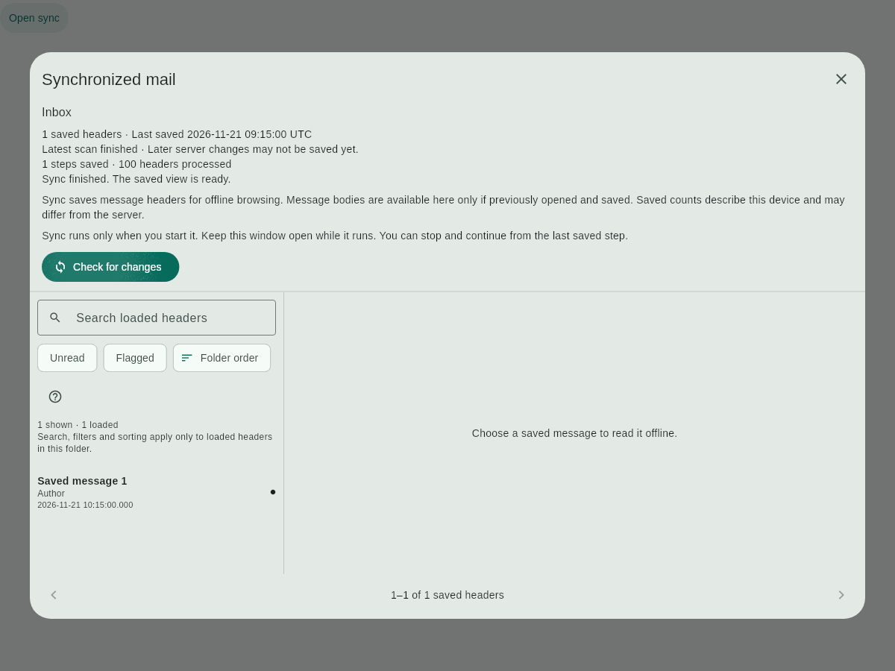

# Mail synchronization foundation — local qualification

This increment adds explicit, resumable folder-header synchronization and an
offline synchronized-mail view to Studio's native IMAP, EWS, Gmail and Microsoft
365 hosts. The [feature contract](../../roadmaps/mail/durable-sync.md) describes
the user workflow, persistence guarantees and remaining parity milestones.

The tested integration checkpoint is
`278fa78d59f219965a50f025dbdb11d1b7b98676`, Git tree
`fd868bec7aed01d2134f72308096ea438129760b`. Later documentation/evidence commits
preserve that implementation. The subsequent `main` publication of App Store
screenshots is reconciled as described below. GitHub Actions was neither polled
nor awaited; acceptance uses the executed local results recorded here.

## What changed

- A typed `MailSyncRunner` bounds each run, retains the last acknowledged
  checkpoint, supports cooperative cancellation and prevents continuation loops.
- SQLite schema v8 stores revision, timestamp and continuation state in the same
  transaction as headers, memberships, tombstones and provider cursor. Bounded
  snapshot/query observers distinguish synchronized folders from browse windows.
- Stable account fingerprints let a new authenticated session resume the saved
  provider cursor. Session leases still reject work from retired connections.
  Header IDs preserve existing cached bodies and draft ownership.
- **Synchronized mail** provides explicit start/continue/check actions, progress,
  partial/completed observation states and local pagination. **Cached mail →
  Synchronized mail** works without credentials. EN/DE/AR controls and compact
  reader navigation are included.

## Repository intake and preservation

The [initial intake](intake.json) accounted for 342 refs: 46 fork branches,
288 fork PR heads and eight upstream refs. Of these, 316 were ancestors, 24 had
exact historical-equivalence proofs, and two refs pointed at the same outstanding
performance-documentation commit. That commit was merged before implementation.

The [pre-publication snapshot](pre-publication.json), captured at
`2026-11-21T07:29:03.131403+00:00`, accounted for 345 refs: 48 fork branches,
289 fork PR heads and eight upstream refs. It found the newer fork `main` plus
Word and Zotero continuations. Both distinct incoming branch heads were merged
and locally qualified:

| Incoming work | Captured head |
| --- | --- |
| Word VBA header/footer selectors and ownership guards | `4b47520ae44dc545b898713d6e22370b66767acd` |
| Zotero research-content replacement within one table cell | `a6095c304ad2d6935f2ae6f8b74412038d19f142` |
| Fork main included by those branches | `e2abbcda6d19f932bfbacc85e0dafd41a3c478f8` |
| Upstream main, unchanged during intake | `15c5d29b63fb17a93c7fb3426a8fd4d95a32f1ba` |

The [final captured-coverage check](final-captured-coverage.json) recomputed every
proof at the integration checkpoint: **321 refs are ancestors and 24 have exact
equivalent content in historical ancestors; zero captured refs are uncovered**.
Equivalence is based on exact Git trees or the complete changed-path set, not
matching commit titles. These are bounded observations of a concurrently active
repository, not a claim that branches cannot advance later.

While preparing publication, `main` advanced again to
`eb286fb7254d6850c9f33b46e8aa65e2ea32f7f0` through PR #290. That commit was also
merged. Its delta is six App Store PNGs and their standalone screenshot gate;
it changes no production Dart source. The separate
[publication applicability record](publication-applicability.json) records the
exact delta and its relationship to the test fingerprints.

Remote checkpoints were saved incrementally on
[`work/mail-sync-foundation-20261121`](https://github.com/CrispStrobe/quds_office_suite/tree/work/mail-sync-foundation-20261121):

| Checkpoint | Purpose |
| --- | --- |
| `cf7a5df588f2efccc4a1da89a54aede705480984` | Reconciled initial intake and performance documentation |
| `d9d75300f7eec0eeecc8fdee05bc02fb6ad3db0b` | Core bounded synchronization runner and tests |
| `93ef36747dfd71c5f40438e9ba3c2ccf156034f7` | Durable store state, queries and migrations |
| `45f0e5038e05e57f121554f976bf74e59af126f6` | Native/provider host workflow, offline UI and regression tests |
| `278fa78d59f219965a50f025dbdb11d1b7b98676` | Captured Word/Zotero histories and combined source |

GitHub Git-data trees were compared with local `git write-tree` output before
updating the remote branch. Ref updates use the expected previous SHA and do not
force history. The final evidence commit also preserves the latest captured
`main` ancestry. The normal GitHub PR merge retains the checkpoint history.

## Executed local results

The following rows count separate suites. Earlier standalone dialog/host runs
are retained as development evidence but are not added again to these totals.

| Scope | Passing tests | Evidence |
| --- | ---: | --- |
| Complete mail core suite | 271 | [receipt](core/receipt.json), [raw output](core/core_all_tests.log) |
| Complete mail store suite | 825 | [receipt](store/store-all-tests-receipt.json), [raw JSONL](store/store-all-tests.jsonl) |
| IMAP discovery/cursors, EWS and cloud provider fixtures | 255 | [receipt](core-transport/providers.json), [raw output](core-transport/provider_sync_tests.log) |
| Transport/store integration | 10 | [receipt](core-transport/provider_store.json), [raw output](core-transport/provider_store_sync_tests.log) |
| Final combined Studio mail host/UI regression cohort | 407 | [receipt](final-mail/mail-host-receipt.json), [raw JSONL](final-mail/mail-host-tests.jsonl) |
| **Mail total** | **1,768** | |
| Captured Word/Zotero engine regression suites | 689 | [receipt](incoming/engine.json), [raw output](incoming/incoming_engine_tests.log) |
| Captured Zotero editor controller regression suite | 109 | [receipt](incoming/editor.json), [raw output](incoming/incoming_editor_tests.log) |
| **Combined total** | **2,566** | |

All listed commands exited successfully. The final combined host cohort reports
407 passed, zero failed, zero skipped and no error events. The full store run
includes real native SQLite rollback/reopen and subprocess termination coverage.
Provider fixtures use fake network boundaries; they do not contact live accounts.

The final host cohort covers the existing loaders, mailbox stores, EWS/cloud
hosts, workspace and cached-mail flows plus the new sync store, native loader,
dialog and actual-host integration suites. Specific new regressions cover:

- Saved-page interruption and resume after closing/reopening real SQLite for
  IMAP, EWS, Gmail and Graph identities, preserving cached bodies and drafts.
- A fresh IMAP UIDVALIDITY reset despite the foreground folder's previous
  generation, and rejection of a disposed loader's late page after reconnect.
- EWS/Gmail/Graph host connect, explicit start, interruption, reconnect/resume
  and offline discovery after removing foreground browse windows.
- Account mismatch and late callbacks, cancellation/close draining, pagination,
  partial/completed states and compact German/Arabic layout.

Additional checks:

| Check | Result and scope |
| --- | --- |
| Strict analysis | No issues in core/store packages and every changed mail host/test target; [log](final-mail/analyze.log) |
| Dart formatting | All 22 changed mail Dart files already formatted; [log](final-mail/format.log) |
| Whitespace | `git diff --check` clean |
| Core portability | Real Dart-to-JavaScript compilation and Node execution passed; [receipt](core-transport/core_js.json) |
| Store browser entry | Real JavaScript compilation passed; [log](final-mail/store-browser-compile.log) |
| Captured Word BAS | Complete committed example compiled to JavaScript and ran in Node; [receipt](incoming/word_js.json) |
| UI rendering | Actual-font desktop EN and compact EN/DE/AR screenshots inspected; [receipt](ui/receipt.json) |

The Word BAS smoke covers 11 operations, six header/footer story variants, two
additional reopen cycles, opaque payload preservation and validation/execution
rollback. Store browser compilation does not establish browser execution, OPFS
worker behavior or a complete Flutter web build.

## Evidence integrity and runtime

The [evidence index](evidence-index.json) preserves original receipts byte for
byte, hashes their raw outputs, and independently compares recorded source paths
against immutable Git blobs. The final host run records before/after SHA-256
hashes for 981 source/test/dependency-definition files. All remained identical
during that run. The final core run has its own unchanged 35-file scope; the
store, transport and incoming-feature receipts retain their scoped hashes.

Some receipts are deliberately historical: the standalone five-host run predates
three incoming engine changes, and an asynchronous UI review predates the final
layout polish. Their limitations remain visible in the index. The later combined
host run and final UI rendering provide the applicable results. Broadly captured
but unexecuted screenshot-gate changes are explained separately in the
publication applicability record rather than rewriting the original receipts.

The local runtime used the repository's Flutter **3.47.8** / Dart **3.13.7**,
the genuine native SQLite **3.54.1** hook binary with FTS5, and Node **24.22.3** for
JavaScript smoke execution. The official SDK archive and 202 locked Pub archives
were verified; offline lock-enforced resolution left `pubspec.lock` unchanged.
See [runtime](runtime/runtime.json) and [Pub cache](runtime/pub-cache-receipt.json).

To reproduce, resolve the pinned workspace dependencies, then run the exact
commands in each receipt from its named package directory. In this environment,
the ordinary `dart test` launcher stalled after native hooks; the recorded
commands invoke the genuine locked `test-1.31.1/bin/test.dart` runner with
`--disable-dart-dev`, the workspace package configuration and `--compiler=kernel
--platform vm`. Flutter host tests use `flutter test --no-pub`. This changes the
launcher, not the package under test or its SQLite implementation.

## Remaining acceptance boundaries

This is a manually started foreground header-sync slice for one selected folder.
Bodies and attachments are readable only if previously cached; no background
scheduler, unified inbox, account-wide search, durable move/archive/delete,
server Drafts conflict handling or complete rich-composer parity is claimed.
Provider authentication prerequisites and existing foreground-browse limits
remain. Live provider accounts, installed desktop/mobile builds and Apple
packaging were not requalified by this work. The
[ordered next increments](../../roadmaps/mail/durable-sync.md#next-ordered-increments)
keep those gaps explicit.

## Rendered previews

Compact variants: [English](ui/compact-en.png), [German](ui/compact-de.png),
[Arabic](ui/compact-ar.png).
