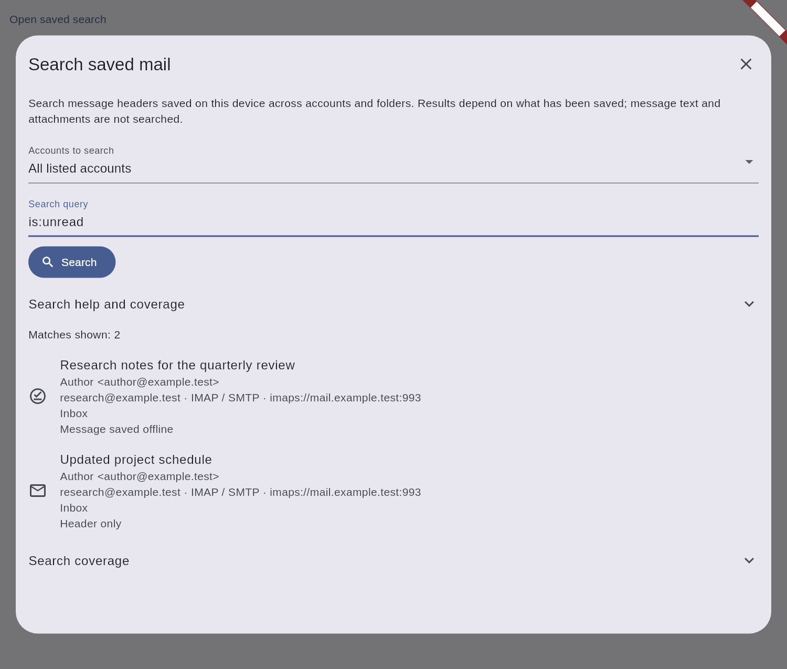

# Unified saved-mail search — implementation and local qualification

This increment moves the existing Boolean header query beyond the loaded
single-folder page. **Search saved mail** is available from Studio's native
local-account chooser, across all listed accounts or one account, with the
provider scope of the chooser retained. It covers the existing IMAP/SMTP, EWS,
Gmail and Microsoft 365 caches.

The [user and ownership guide](../../roadmaps/mail/unified-cached-search.md)
describes the workflow, query examples, coverage contract and next parity
increments. The wider [Mail implementation plan](../../roadmaps/mail/implementation-plan.md)
remains open; this is a completed discovery increment toward desktop mail
parity, not a claim of a complete Outlook/Thunderbird/eM Client replacement.

## Implemented behavior

- Search the union of saved browse-window and authoritative synchronization
  memberships using the same portable Boolean evaluator. Deduplicate canonical
  messages within an account while retaining folder/label provenance and
  keeping equal IDs from different accounts separate.
- Validate the whole bounded query before opening an account. Preserve the
  existing unknown flag/date, Unicode and local-calendar semantics. Bcc,
  body text and attachment text are outside this header-search contract.
- Inspect at most 500 candidates per default call, with a maximum of 1,000;
  return at most 100 matches by default. Repository result limits can reach
  200 subject to store configuration. A zero-hit page can still have more
  candidates. The UI retains up to 1,000 matches and requests refinement if
  the selected scope remains unchecked.
- Bind opaque continuations to the account, exact query, repository owner and
  committed content generation. Reject stale or inconsistent pages instead of
  silently skipping candidates or certifying incomplete coverage.
- Show independent per-account scan coverage, observed folders, capture times,
  provider continuation and failures. A failed account remains incomplete;
  successfully checking saved headers does not establish server completeness.
- Open retained message bytes only after selection. Report missing bodies
  explicitly, with no implicit server request. Retire stale readers/results
  on query, scope or parent-context changes; drain operations and owners on
  close, with visible retry after a close failure.
- Provide English, German and Arabic controls, LTR query grammar in RTL
  layouts, isolated sender addresses and readable compact result provenance.

The query performs no writes and does not read body/blob/draft/Outbox payloads.
The existing native opener still performs its normal profile/account setup and
interrupted-operation recovery before querying. That opening behavior can
update local metadata and recovery records. Search adds no schema migration,
dependency, credential request, provider operation or automatic submission.

## Reconciled incoming work

The [initial intake](intake.md) captures all 24 starting fork branch heads,
all 300 fork PR heads and all four upstream branches/four upstream PRs. It
includes the Word text continuation and preserves both Boolean regression
cohorts without replacing newer Mail behavior.

The refresh captured **27 fork branch heads and 302 PR heads** at
2026-11-21 10:47:48 UTC. All 27 heads are ancestors of checkpoint `76a51def`.
Of the 302 PR heads, 288 are ancestors and 14 have freshly rechecked exact
historical equivalence proofs. Thirteen proofs compare complete trees; one
compares the complete changed-path set. The additional older three-path proof
was also rechecked. No captured head is uncovered.

Main then advanced through **PR #303**, the Zotero qualification record, to
`0214f49a2e9e5d7b459be90b6ebd948d262c6dd6`. Its nine-path delta contains only
documentation/evidence. It was merged at
`a0a3593a3658086bf1582c3ca87b3fa91485a7de`, preserving all **6,188 Git blob/mode
entries outside `docs/`** from the final tested source. The sole README add/add
resolution retains the incoming canonical record and our
[independent qualification](zotero-independent-qualification.md) separately.
The refreshed history therefore records **303 pre-publication PRs**.

The incoming work includes the Word text functions, bounded native ODT Zotero
inventory, optional macOS Touch ID vault unlocking and the typing-benchmark
runtime switch. Review corrected two incoming failure areas before publication:

- Credential enrollment now durably records disabled state before a key write,
  retries incomplete removal across restart/backend changes, exposes a redacted
  retry state, rejects stale selected-vault enrollment and retains usable
  password/Cancel controls after manager errors. Native access-control flags
  and passphrase verification were not weakened.
- The typing benchmark captures/restores its prior optimization flags. Its
  baseline switch was exercised on the actual 300-keystroke Studio path in
  both modes; a separate probe verifies restoration from disabled flags.

## Remote checkpoints

All checkpoint updates used the expected prior head and were non-forced. The
working branch is retained as
[`work/mail-unified-cache-20261121`](https://github.com/CrispStrobe/quds_office_suite/tree/work/mail-unified-cache-20261121).

| Checkpoint | Purpose |
| --- | --- |
| `db00cf411b21cb8c26878adaa535ffaa5e7e62db` | Initial main/Word reconciliation and both Boolean cohorts |
| `02afd5394c77bdbafbad8e3790825c77598cf84d` | Repository query, native adapter/session and initial regressions |
| `833ddd05ff8cdecb202d6db414e66b91f2332544` | Strict host pagination validation and account bounds |
| `dc0aa1c522f024ab60d6a06a1411f09b1a40ad98` | Localized UI, reader, parent-context guards and roadmap |
| `4ecf9850e0292436fdaf2af034e6758fceb247ba` | Updated main / Word PR #301 |
| `8e62c444feea8afb20a1621858bad899bc7c1d23` | Qualified Zotero inventory continuation |
| `968a216c7fc77e06014653584242f3a4c02940bd` | Preserve incoming Touch ID branch for correction |
| `76a51def02fc45f86907277d5759bccf731cbb45` | Preserve late typing-benchmark branch |
| `020740dc1d58c28b62c938bc9587921ccf55f830` | Restore prior benchmark flags |
| `62e9f1af15f2cb00ee67a339cdc6dea48d882aab` | Corrected credentials and final combined tested code |
| `a0a3593a3658086bf1582c3ca87b3fa91485a7de` | Later main documentation/evidence reconciliation |

This record's subsequent commit adds evidence and documentation only. Its
runtime source is bound by [source-continuity.json](source-continuity.json).

## Actual local execution

The genuine repository-pinned **Flutter 3.47.8 / Dart 3.13.7** runtime was used,
with **Node 24.22.3** for portable comparisons. The official Flutter archive
SHA-256 is `baf7dcc5a3dbba60fe863bf493a6cf203195621f7786eaa5a1bba02cd0d87dd2`.
Locked dependency resolution completed offline after verifying the hosted
archives. Tracked manifests and lockfiles remain unchanged; root lock SHA-256
is `0d64a732cd7f6c7cc4e1e01255276f081b59e6f43039636c3d36f6785a958ce2`.
Repository and host storage tests used real native SQLite and native account
profile files, with typed fakes only at the deliberate host/provider boundaries.

| Distinct selected cohort | Passed | Scope |
| --- | ---: | --- |
| Mail core | 407 | Complete suite, including both Boolean cohorts |
| Mail UI | 211 | Complete baseline suite; all 191 captured inputs still match |
| New cached-header repository search | 19 | Deduplication, membership coverage, bounds, stale cursors, rollback and a 1,002-header continuation |
| Existing mailbox-view/synchronization regressions | 34 | Existing observer and sync behavior around committed-change notifications |
| Combined Studio Mail/credentials | 178 | One final 11-file run: 93 cached-Mail cases plus 85 credential cases |
| Word text continuation | 263 | Three focused suites rerun on merged engine source and corrected fixture provenance |
| Native ODT Zotero inventory | 149 | Four focused parser/ownership/preferences/resource suites |
| **Total in these disjoint cohorts** | **1,261** | **Zero final failures or skips** |

The final combined Studio and core runs used clean checkpoint `62e9f1af`.
Their 1,169 and 71 source/dependency fingerprints, HEAD, tree and index remained
unchanged throughout execution. The later main merge and this evidence update
do not change runtime inputs. The other cohort bindings were independently
rechecked against the final source; every recorded input matches.

Additional runtime checks passed without inflating that total: all 95 Word
canonical cases have byte-identical VM/Node output; the six-operation Word
report agrees after two additional reopens with rich formatting and opaque VBA
preserved; the ODT inventory acceptance agrees byte-for-byte on VM/Node.
The opt-in typing benchmark passed in optimized and baseline modes and restored
its prior settings. Debug benchmark timings do not establish release performance.

Strict targeted analysis and formatting passed for the new search, UI/session,
credential corrections, ODT inventory and benchmark correction. The macOS build
script passed shell syntax checking. No GitHub Actions, workflow-run, check or
commit-status queue was queried or awaited as an acceptance dependency.

## Evidence, failed attempts and visual review

- [validation.json](validation.json) records counts, runtime, source bindings,
  overlap rules, warnings and unexecuted gates.
- [local-evidence.tar.xz](local-evidence.tar.xz) preserves exact commands,
  timestamps, exit codes, raw logs, before/after fingerprints, patches,
  synthetic fixtures, intake proofs and portable stdout receipts.
- [evidence-files.json](evidence-files.json) lists each archive member's byte
  count and SHA-256; [visual-files.json](visual-files.json) binds eight captures.
- [Source continuity](source-continuity.json) connects scoped executed inputs
  to the reconciled source; the complete 6,188-entry Git proof is archived under
  `final-intake-20261121/post-cutoff-0214f49a/`.

Development failures are retained separately. The original credential source
reproduced seven recovery failures before correction. Earlier fixed-frame
dialog-close assertions and a compact-help test helper failed before their
observable-completion corrections. The old close route/helper blobs were
unchanged from intake; the attempted scratch baseline could not finish native
asset setup and is not counted as a test pass. Initial incomplete SDK/startup
and empty Node-output attempts likewise contribute no passing count.

The final combined Studio log contains 51 warning-print events, including
Drift's multiple-database debug warnings for independent native account
profiles. They remain visible in the raw evidence; this is not a warning-free
claim. The final test exits and typed error events are successful/zero.

Eight widget captures cover English, German and Arabic, wide and compact forms,
results and explicit offline reading. Root visually inspected sender direction,
query direction, compact provenance/body status and reader layout after fixes.
These are synthetic widget-runner captures, not installed desktop-app acceptance.

## Reproduction and remaining gates

Use the pinned SDK and resolve the checked-in workspace with
`flutter --no-version-check pub get --offline --enforce-lockfile` when the
locked cache is already populated. The archive's receipts contain each exact
command and working directory. `tools/run_final_mail.py` records the final
eleven-file Flutter invocation and complete native core invocation, including
JSON event accounting and before/after source capture. The portable receipts
record compilation and the required Node `globalThis.self = globalThis` prelude.

Actual macOS Touch ID, protected-keychain entitlements, signed-app execution,
live mail-provider behavior and installed Office/Zotero interoperability were
not executed in this Linux environment. Browser persistence and release
packaging across supported platforms remain separate gates. No real biometric
prompt, signing, provider submission or real-credential operation was performed.

Next Mail increments are saved live searches and broader indexed/server
discovery, conversation grouping and the shared synchronized workspace, durable
archive/move/delete and rules, richer authoring/sending workflows, and provider/
platform release qualification. Each needs a usable route, bounded failure and
recovery behavior, actual local qualification and a remote checkpoint.
