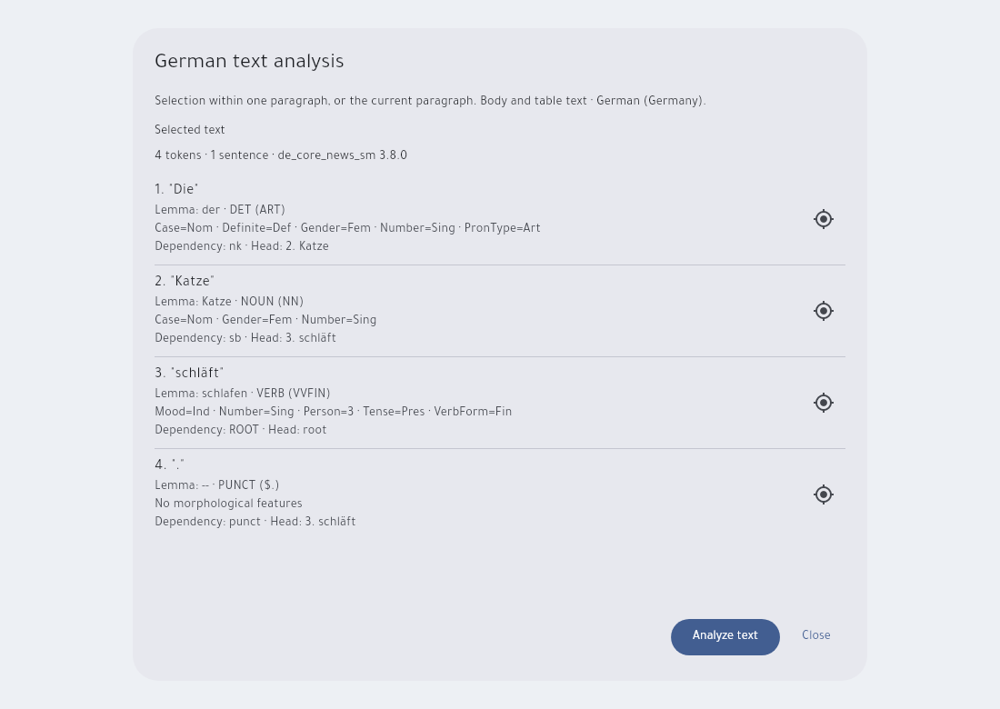

# Native spaCy Dart/editor continuation — 17 November 2026

## Completed checkpoint and scope

W5 adds the optional [Dart package](../../../packages/quds_proofing_spacy/README.md),
a persistent isolate worker, and **Review → German analysis → Analyze text** in
the Studio example. The qualified target is **Linux x86-64/AVX2, de-DE,
CPU/F32**, using the exact accepted native library and model. The view analyzes
one original body/table paragraph, or a selection within it, and navigates
annotations back to the original text without editing the document.

All local checks pass on the reconciled source. Quds main
`16e2477ff93f7a1ec5c6ed78491f2716ce4d1658` was merged and saved at `4471324a`
before implementation. A later refresh found four new main commits, ending at
`4b2b4e78839d2997a583b7ab1346e2fa537a8ac4`; the completed UI was saved at
`b5b1fa99` before that main was merged and saved at
[`8d89e4f7cdecdfd43c632994649f4e91d4cf109c`](https://github.com/CrispStrobe/quds_office_suite/commit/8d89e4f7cdecdfd43c632994649f4e91d4cf109c).
[The reconciliation receipt](main-reconciliation.json) records exact parents,
trees, refreshed refs, incoming commits, preserved fixture hashes and the
independent source audit. Superseded Office branches remain recorded in
history; their replacement main commits are integrated once.

No grammar provider is registered. Existing deterministic proofreading,
correction and undo paths remain authoritative. The native gate stays default
off. Grammar benefit, other platforms, device packaging, distribution and a
production release remain later gates. No GitHub Actions endpoint was queried,
polled, awaited or rerun; remote checkpoint messages use `[skip ci]`.

## Evidence map

| Evidence | Result and boundary |
| --- | --- |
| [Restored runtime](runtime-restoration.json) and [native API controls](restored-api-controls.json) | Original native archive, dependencies and bundle authenticated; 21 existing actual-model API groups pass. No native rebuild or held-out rerun. |
| [Source-sealed direct FFI replay](dart-development-sealed.json) | 16 development documents, 113 tokens, 22 sentences, 2,571 exposed-field comparisons, zero differences; 10 authored controls. |
| [Source-sealed actual-worker replay](dart-worker-development.json) | The same 16 documents and comparisons through the persistent worker, plus the same 10 controls. Repeated runs do not add unique linguistic cases. |
| [Malformed native FFI probe](native-fault-probe.json) and [build identity](native-fault-build.json) | 20 controls against a compiled test-only C fixture; 30 exact document frees, zero live documents or contexts. No trained inference in this probe. |
| [Package validation](package-validation.json) | 29 tests: 15 core/bundle controls and 14 actual isolate protocol controls. Package analysis is clean; public/native browser imports compile and report unavailable without FFI. |
| [Studio qualification](ui-validation.json) | 22 source-snapshot/widget controls and one real-model native widget gate; source navigation, stale results, cancellation, close, failure and retry ownership checked. Studio analysis and browser import checks pass. |
| [Final merged-source checks](merged-gates.json) | Offline dependency resolution, all 29 package tests, 22 UI controls, 75 existing proofing regressions, one real-model widget gate and static analysis pass after the latest main merge. Source, lock and native bytes remain unchanged during the checks. |
| [Completion record](completion.json) and [artifact index](evidence-index.json) | Exact scope, remote checkpoint sequence, qualification limits and hashes for every retained file in this evidence directory. |

The original native first acceptance remains at
[CrispEmbed `2176c89`](https://github.com/CrispStrobe/CrispEmbed/commit/2176c896dc6bb8c832a9d03b04fd07c7c991fdc5):
eight cases, 98 tokens, 13 sentences, 201 parser transitions, 294 classifier
choices and 851 numerical stages / 1,068,891 F32 values, with exact discrete
outputs and maximum error `5.340576171875e-5`. Adapter qualification reuses
development cases and separate authored controls; it does not reopen that
consumed acceptance split or establish grammar-correction accuracy.

## Runtime and source identity

The frozen native binary SHA-256 is
`ea89842ebf22c08508aff1cfbf18d78a107118af320523009616ff62b6e42977`.
The five-file bundle manifest is
`d599768375de3dc56abcca5cf1d49da0015857f9d3a10640aebb5317ef5d427e`.
The target uses PCRE2 10.46. All 15 installed files and six resolved dependency
binaries match the saved installation. The original model wheel and all bundle
files are authenticated by the restoration receipt.

Flutter 3.47.8, Dart 3.13.7 and all 162 original Pub archives were authenticated.
The workspace resolves offline with the retained
[lockfile](workspace-pubspec.lock). Its SHA-256 is
`344190a0224b9e6dcc2161cbfb1be3b7a9569a3a03a809f42801d99f9052e130`.
Setup logs remain in [runtime-logs](runtime-logs).

The latest-main merge changes none of the 22 package files or the ten Studio
source/font/manifest paths recorded by the UI receipt. All 20 acceptance
fixture files and 36 development fixture files match the original reference
commit `4ae8e9e0e9b83b1a01176485bae55d9595e99b1c`. Exporter and reference
tooling remain exact; only their README has a continuation update. Before/after
hashes in the direct, worker and final merged-source receipts match current
executable sources. Existing first-run evidence is preserved verbatim.

## Source and lifecycle contract

The counted-string binding validates the original UTF-16 text before UTF-8
encoding, retains embedded NUL, and checks native byte/scalar/UTF-16 coordinates
against that unnormalized source. Results own immutable Dart strings and lists.
It validates full text reconstruction, sentence coverage, one structural root,
same-sentence heads and absence of dependency cycles, then frees the native
document even on malformed outputs. A token's UTF-16 range is relative to the
request; the host adds the original selection origin exactly once.

The worker sends at most one full request to the isolate at a time. It bounds
waiting callers, coalesces obsolete snapshots and authenticates replies against
the exact request and runtime identity. Tests cover 200 superseding requests,
queue saturation, invalid replacement admission, timeout, cancellation,
unexpected exit, snapshot/runtime mismatch and delayed-startup cleanup.

Cancellation and timeout settle callers promptly; only the actual native reply
releases the physical slot. Shutdown joins context cleanup after an active call
returns. The worker never kills an isolate to simulate native cancellation.
Prompt interruption of native compute is not claimed by the Dart adapter.

The Studio snapshot binds the document, owned paragraph, revision, exact text,
language, configuration, generation and UTF-16 origin. Edits or ownership,
locale, document and configuration changes invalidate pending or displayed
results. Header/footer/comment/frame/generated-TOC text, selected objects,
cross-paragraph selections, mixed languages and non-de-DE units are rejected.
Only an explicit new action starts or retries analysis; typing and ordinary
proofreading do not run the model.

## Actual editor result

The real native widget gate supplies `😀 Vorlauf. Die Katze schläft.` and
selects `Die Katze schläft.` at UTF-16 origin 12. The actual host factory and
worker return four tokens and one sentence, including lemmas `Katze` and
`schlafen`. Revealing `Katze` selects the exact original range **16–21**.
Document text remains unchanged, no undo item is created and shutdown completes.
This is one authored input, repeated for rendering and final merge checks.



The final 1100×780 rendering has four readable token rows and real font/icons.
Its bytes match the previously reviewed [UI rendering](analysis-panel.png)
exactly. This is a visual inspection and a functional widget test, not a full
packaged desktop application or a golden-image comparison.

## Reproduction

Use the pinned SDK and verified local installation described by the receipts.
Place the native library in a directory named by its SHA-256 and keep its
dependencies/notices installed immutably. Before starting the Linux example:

```sh
export CRISPEMBED_SPACY=1
export QUDS_SPACY_BUNDLE="$VERIFIED_BUNDLE"
export QUDS_SPACY_LIBRARY="$NATIVE_SHA_DIRECTORY/libcrispembed-spacy.so"
export QUDS_SPACY_LIBRARY_SHA256=ea89842ebf22c08508aff1cfbf18d78a107118af320523009616ff62b6e42977
```

Open **Review → German analysis**, select text within an eligible German
paragraph or place the caret in it, and choose **Analyze text**. Opening the
dialog alone does not load a model. Missing/disabled assets are visibly
unavailable; the application does not download a model or start Python,
a daemon, a subprocess or remote inference.

From the repository root after offline dependency resolution:

```sh
flutter test --no-pub packages/quds_proofing_spacy/test --reporter expanded
flutter test --no-pub packages/quds_office_editor/example/test/studio_linguistic_analysis_test.dart --reporter expanded
QUDS_SPACY_PANEL_OUTPUT="$NEW_PANEL_PNG" flutter test --no-pub packages/quds_office_editor/example/test/studio_linguistic_analysis_native_gate.dart --reporter expanded
```

The explicit native gate fails if assets/configuration are missing and refuses
to overwrite its PNG. Package documentation contains direct/worker replay
commands, and [merged-gates.json](merged-gates.json) retains all final commands,
timeouts, source hashes and log identities. Fresh report paths are required.

## Retained failures and review fixes

[The first Dart result](dart-development-first.json) exposed an overly strict
root-label assumption: original spaCy labels the whitespace-only self-headed
root `dep`. The adapter now validates the structural contract without imposing
`ROOT`. Goldens and native bytes were unchanged. Its initial diagnostic path
sanitizer replaced a relative dot too broadly; later reports replace only full
absolute paths. The exact 15-file first-run source closure is preserved in
[the source archive](dart-development-first-source.tar.gz), authenticated by
[its manifest](dart-development-first-source.json). The initial corrected
[direct replay](dart-development-final.json) has after-only source identities;
the later sealed receipts supply before/after identities.

The initial convenience `dart test` command stalled on implicit setup and was
interrupted. Explicit offline Flutter/cached runners succeeded. Early developer
web/UI harness compilation and fake-clock waiting failures, and the first
font/view-size render, remain recorded in package/UI receipts and raw logs.
Independent review found two lifecycle retry defects: failed cancelled startup
could retain its opening future, and an unavailable worker could remain cached.
Ownership-specific cleanup and exact regression sequences fix both. Another
review added explicit body/table ownership traversal to exclude frames and
generated TOC. No retained failure was replaced with a success summary.

## Next gate

W6 must measure incremental grammar benefit against the **current deterministic
German baseline at main `4b2b4e78`**, including its latest bounded controls. Freeze
a separate evaluation protocol before judging any new grammar planner. Keep
the consumed native acceptance split unchanged. Other-platform/mobile packaging,
dependency/notices distribution, device performance and production release
qualification remain separate work; this checkpoint activates no provider.
