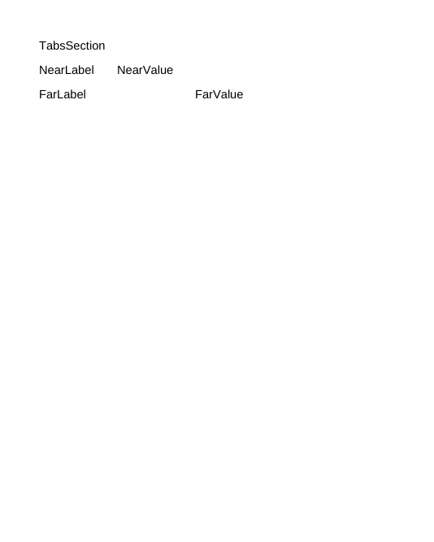
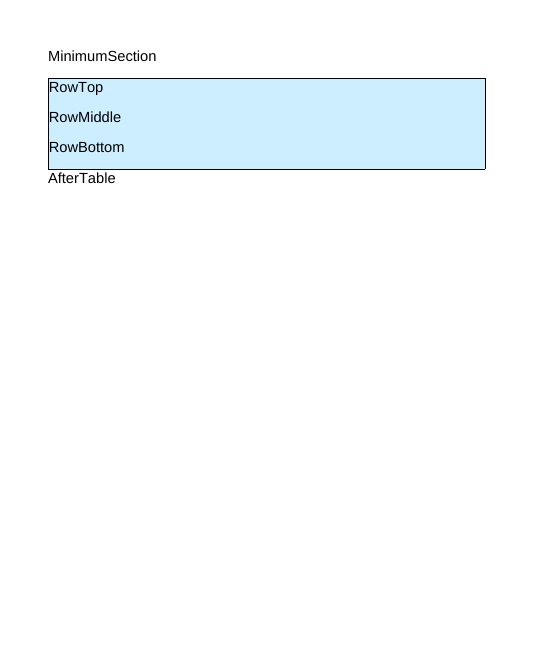
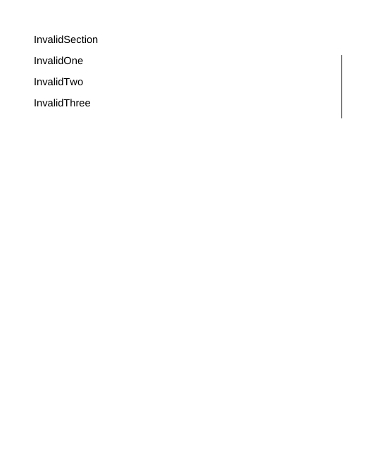

# Fresh ODT consumer qualification

Accepted source: [`ec5ecbff742580c0e7d1136507b953e8cc877e4c`](https://github.com/CrispStrobe/quds_office_suite/commit/ec5ecbff742580c0e7d1136507b953e8cc877e4c), tree `147b6903c88d72fc8844513f6fe357fac6d608c0`.

The fresh run passes **29/29 independent consumer fixtures** and **116/116 official ODF 1.3 XML-part validations**. No historical or failed-attempt pass is added to these totals. The [complete receipt](final-receipt.json) binds the generated packages, commands, consumers, schemas, output hashes and observed geometry.

## Coverage

The previous 26 section, list, paragraph-decoration and live-footer fixtures are retained without changing their specifications or the historical `check_fixture` function. Their exact specification SHA-256 is `19bf753029ae5bf2549b451ee518b1d960478b2f6d6dc9af0f566037e4659845`. Three additional fixtures exercise the newly reconciled writer behavior.

| New fixture | Independently observed result |
| --- | --- |
| Distinct custom tab positions | Reopened DOCX retains left tabs at 1,440 and 2,880 twips, matching the authored 72 and 144 points. PDF text begins at 108.1 and 180.1 points on a page with a 36-point left margin; both meet the unchanged 0.4-point measurement tolerance. |
| Minimum table row | Reopened DOCX retains a six-point `atLeast` row height. All three authored lines render, spanning 57.276 points vertically, with the following paragraph below the table. The cell retains its `CCEEFF` fill. |
| Invalid table properties | NaN, infinity, negative row height and invalid fill strings produce valid ODF. All three cell texts survive. Reopened DOCX retains each authored right border as a half-point black single border and has no custom cell fill. |







The inherited live-footer fixture still shows actual page numbers 1 and 2 followed by the full authored title, with bold blue 14-point text and a real PAGE field in reopened DOCX. The three new rasters and the second-page footer were visually inspected; their exact image hashes and observations are recorded in [visual-review.json](visual-review.json). Other retained fixtures keep their existing numerical checks and tolerances.

## Exact inputs and tools

- All **397 source inputs** and **10,420 runtime inputs** match before and after the accepted run.
- The frozen source HEAD, generated fixture inventory and activated package graph remain unchanged.
- Genuine Dart 3.13.7, LibreOfficeDev 26.8.0.0.alpha0 build `2c87e51eeaa2b413ff4ae097b2705eea1995d8e5`, Poppler and the recorded fonts are used. Exact version output is in the receipt and raw logs.
- Every generated package passes ZIP CRC checking. Its `content.xml`, `styles.xml`, `meta.xml` and `META-INF/manifest.xml` validate against the official schemas.

The schemas were restored from the prior frozen evidence archive and verified against its original OASIS download hashes:

| Schema | SHA-256 |
| --- | --- |
| [ODF 1.3 main schema](https://docs.oasis-open.org/office/OpenDocument/v1.3/os/schemas/OpenDocument-v1.3-schema.rng) | `40bad03efdbb02825230d357da0aa6ac679934c5bf56c6281752c0c24d58e4e6` |
| [ODF 1.3 manifest schema](https://docs.oasis-open.org/office/OpenDocument/v1.3/os/schemas/OpenDocument-v1.3-manifest-schema.rng) | `8aee71f03484be112af972d622cc9031280c007b0a454ae8815e8e333c9bdd17` |

## Preserved initial attempt and oracle correction

The initial run on `60a116d2` passed all 116 schema checks and 28 of 29 consumer fixtures. Its new invalid-property assertion required a physical OOXML `w:right` border. The actual reopened DOCX represented the same trailing edge as `w:end` in an LTR table, with the correct `single`, size `4`, black border values.

The corrected check accepts `w:right` or `w:end` only after verifying that the fixture's table is not bidirectional. It also checks the exact border size and color. No product code or historical consumer expectation was relaxed. An independent review confirmed the table has no `bidiVisual` in the document or styles and no referenced table style.

The initial output, failed receipt and exact executed harness are preserved. Each reconstructed harness file was checked against its recorded input hash. See [oracle-correction.json](oracle-correction.json). The final source differs from `60a116d2` only by removal of an extra blank line in a Dart regression file; the accepted run nevertheless regenerated and checked all 29 fixtures from the final source.

## Evidence and reproduction

The [evidence index](consumer-evidence-index.json) lists all **754 members** of [consumer-evidence.tar.xz](consumer-evidence.tar.xz), a 1,314,732-byte archive with SHA-256 `fda47c8463a9e94981033688d55998aebc297157a77e274a769e9782c82b315a`. Every member was fully read back and checked against its recorded size and hash. It contains both attempts, raw stdout/stderr, generated ODTs, independent PDF/DOCX conversions, extracted text and positions, rasters, input maps, exact harnesses, schemas and the correction record. Temporary LibreOffice profiles are excluded.

Use the locked canonical workspace prepared by the adjacent canonical qualification setup and a fresh output directory:

```bash
python recovery-runner/verify_consumers.py \
  --output /absolute/fresh/output \
  --schemas /absolute/consumer/schemas \
  --dart /absolute/dart-sdk/bin/dart \
  --repo /absolute/resolved/canonical/workspace \
  --source-repo /absolute/frozen/source \
  --expected-head ec5ecbff742580c0e7d1136507b953e8cc877e4c
```

The repository and workspace must activate the frozen source, not another checkout. The runner rejects a different HEAD, modified production libraries, altered historical fixture specifications or changed input maps.

This qualifies the recorded ODT behaviors in the installed LibreOffice development build and the official ODF schemas. It does not establish live Microsoft Word, Zotero, mobile, arbitrary-document or whole-application interoperability. Tab leader glyphs are covered by the separate writer contract regressions; this consumer fixture measures custom tab positions.

No GitHub Actions, workflow, check-run or CI-status endpoint was queried or awaited.
