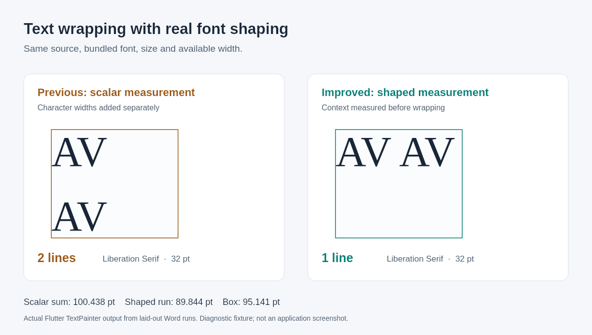

# Font and text rendering: implementation and local qualification

Work branch: [`codex/text-rendering-20261116`](https://github.com/CrispStrobe/quds_office_suite/tree/codex/text-rendering-20261116).
Integration baseline: `bfb24bf57d5efd52f00ab7079b4ac8968259a478`.

**Incremental qualification record.** The contextual line correction is saved
at `48123bf78dd0c23fe17e675306e047f1c993060b`. Full engine qualification and
two additional source/fallback edge-case corrections are in progress at this
documentation checkpoint. Passing results below apply only to their stated
source snapshots; this intermediate record is not a final all-green claim.

## Incoming work

The work started from the consolidated incoming branch after fetching both the
fork and original upstream, including PR heads. All **132 observed incoming
heads** are ancestors of the chosen baseline: 62 branch heads and 70 PR heads.
The [incoming audit](incoming-work.md) and [exact ref inventory](incoming-refs.json)
record the cutoff, exclusions, source SHAs and ancestry checks. Source inclusion
does not imply PR approval, and later remote changes are outside that snapshot.

## What changed

Word pagination previously used isolated-character widths while the editor
painted complete shaped runs. Kerning, Arabic joining and grapheme behavior
could therefore change the width after a line had already been selected.

The editor now measures contextual runs using the same Flutter `TextPainter`
font, fallback, size, weight, style and direction policy used for painting.
The pure Dart engine accepts an optional typed `WordRunMeasure` callback with
complete, validated UTF-16 grapheme ranges. Existing scalar/font measurement
remains available to hosts without a contextual shaper. The callback does not
introduce Flutter or `dart:ui` into the engine.

Paragraph-context measurements are still only estimates for a final line:
trimming a space or removing neighboring letters can change shaping. The
breaker therefore remeasures the actual painted fragment, including a chosen
discretionary hyphen, and repairs overflow at earlier legal boundaries. The
same check applies to adaptive text bands around floating frames. Repair work
is bounded to 32 candidate measurements per overflowing interval; indivisible
oversized words or graphemes retain their existing overflow behavior.

Other changes keep lam–alef continuations in their source script font, retain
natural widths for left/center/right paragraphs, guard source grapheme break
boundaries, preserve styled combining-mark ownership and exact bidi embedding
levels, invalidate width caches after font registration, and release temporary
native text painters. Cached run metrics contain immutable Dart values and
have explicit entry and text-size bounds.

## Actual rendered comparison

The fixture uses bundled Liberation Serif at 32 points, text `AV AV`, and the
same 95.140625-point content box in both controllers.

| Path | Width used before wrapping | Lines |
| --- | ---: | ---: |
| Previous scalar measurements | 100.4375 pt | 2 |
| Contextual shaped measurements | 89.84375 pt | 1 |

The improved line remains 89.84375 points before and after paint fitting.
The [metrics](metrics.json) contain the full measured values. The image is an
actual Flutter test-engine Canvas/`TextPainter` diagnostic, not a screenshot
of the full application. The [rendering tool](../../../packages/quds_office_editor/tool/render_text_comparison.dart)
requires an explicit output directory and is reproducible locally.

The stricter 73.2-point table-cell regression exposed a separate boundary
problem: a paragraph-estimated 73.125-point fragment grew to 73.450195 points
after trimming. The actual-fragment check now chooses an earlier break. The
same regression is covered for a floating-frame band that widens from 73.2 to
173.2 points; its geometry tolerances were not relaxed.

## Qualification to date

All execution uses the real local Flutter 3.47.8 / Dart 3.13.7 runtime.
The [runtime record](runtime.json) pins framework/engine revisions and platform;
[resolved dependencies](resolved-dependencies.yaml) record the exact package
resolution. Production dependency manifests are unchanged. No GitHub Actions
jobs were polled, awaited or rerun.

| Local check | Result at this checkpoint |
| --- | --- |
| Initial broader editor cohort, 33 files, source `48123bf` | 432 passed; one inherited mode-test mismatch failed |
| Corrected focus/navigation test file | 5 passed |
| Run metrics / strict controller integration checks | 13 / 8 passed before the broad cohort; these overlap the cohort and are not additive totals |
| Actual Flutter comparison render | 1 passed |
| Scoped static analysis of 18 changed Dart files | No issues |
| Formatting check | Four layout-only formatting differences in `render_word_canvas.dart` identified for correction |
| Entire engine test directory, 185 files | Running locally; final receipt follows |

The initial editor cohort excluded only the two tests named `Word-like selection
golden`, whose platform-specific image baselines were not regenerated. Selection
geometry and pixel-difference assertions remained enabled. Its JSON receipts
count distinct visible test IDs, omit hidden loader/setup events, and preserve
the failure rather than hiding it. All 494 recorded inputs were unchanged
during that run. See [its summary](editor-broad-initial-summary.json) and
[baseline identity evidence](editor-incoming-test-mismatch.json).

The failed incoming test asked viewing mode to allow selection/navigation.
The existing public mode contract reserves viewing for scroll/zoom and uses
selecting for selection/copy without mutation. Both the original test and mode
policy were byte-identical to the integration baseline. The test now requests
selecting mode; the production interaction policy has not changed.

## State of the art and licenses

The [strategy and license review](../../text-rendering-strategy.md) compares the
existing Flutter stack, HarfBuzz/ICU, FreeType's FTL license route, Skia, the
Parley/Fontique/HarfRust/Skrifa/ICU4X Rust stack, COSMIC Text/Swash and SheenBidi.
It links primary upstream documentation and licenses and distinguishes font
processing, shaping, paragraph layout and rasterization responsibilities.

This increment uses the existing Flutter shaping stack and introduces **no new
package or native dependency**. No GPL or LGPL component was added. FreeType's
FTL option is a possible BSD-style route for a future build; its alternative GPL
license is not the selected route. A future native/Wasm backend requires a
pinned, feature-specific dependency and notice audit before adoption.

The separate [font audit](font-license-audit.json) records all 14 bundled font
hashes and embedded metadata. Liberation Sans/Serif/Mono 2.1.5 (12 faces) and
Noto Naskh Arabic 2.004 (two faces) use SIL OFL 1.1. Full upstream license and
copyright notices replace the previous short labels. The older GPL-licensed
Liberation 1.x distribution is not bundled here. Font binaries are unchanged.

## Scope and limits

This work improves Word editor measurement, wrapping and source/caret handling;
it does not replace every Office rendering surface. Headless PDF retains its
pure Dart font/glyph pipeline, so editor success is not a claim of identical
OpenType shaping in PDF. A shared export backend would need exact font
identities, glyph IDs/offsets, cluster maps and line-boundary context.

Bounded overflow repair preserves the existing paragraph plan where it fits;
it is not a globally optimal reflow of every line after contextual changes.
The tests provide focused Latin, Arabic, supplementary, combining, bidi and
source-boundary coverage, not complete Unicode/font/platform conformance.
Cache limits and resource disposal are verified implementation properties;
no throughput or memory benchmark claim is made.
