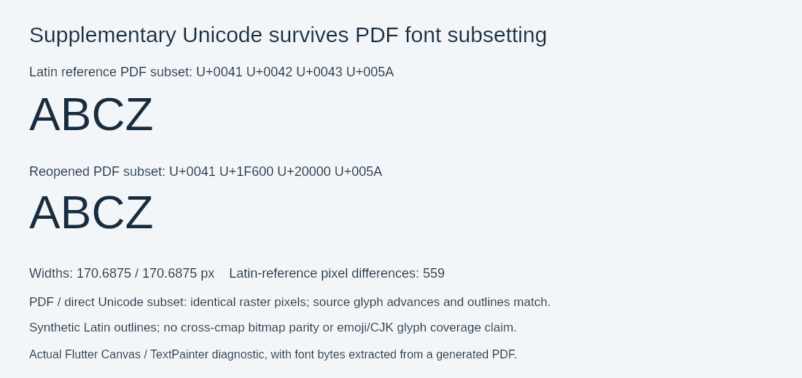

# Text rendering follow-up — 16 November 2026

This continues the [first rendering increment](../text-rendering-20261116/README.md)
on `codex/text-rendering-20261116` / draft PR #72. It fixes embedded-font identity
and Unicode transport in the current PDF path without adding a rendering
dependency. The original Flutter contextual-measurement work remains in place.

## Incoming work first

The refreshed inventory contains **148 refs: 72 branch heads and 76 PR heads**
across the fork and original upstream. All are ancestors of integration
checkpoint `b3b5006c44dd8e0de96fe05b563f3fcfa1b107c0`.
[reconciliation.json](reconciliation.json) records every ref and exact SHA.

The new proofing continuation `95185d2` adds German-rule refinements, review
dialog recovery, and invisible line-control semantics. The merge preserves
contextual line measurement and existing ODS picture support. Five incoming
ODS feature/vendor commits have the same stable patch IDs as their already
integrated main counterparts; the feature image and documentation snapshots
also have identical complete trees. Their histories are retained explicitly.
ODS production source and tests are unchanged by this reconciliation.

The [final remote inventory](final-remote-inventory.json), refreshed at
**2026-11-16 17:09:01 UTC**, still contains 148 refs. Every observed head is
an ancestor of `6b31039ce115b3c4646ec30bea48e7326caf7ca5`; no additional
incoming head was missing. This is an explicitly timed snapshot, not a claim
that remote branches cannot advance later.

The remote checkpoints use `[skip ci]`. **No GitHub Actions jobs, checks or
statuses were queried, awaited, polled or rerun.** Shell-based pushing has no
credentials here; the connected GitHub plugin saves Git blobs, trees and
commits, then advances the branch with a checked expected parent. Retrieved
trees are compared with the local staged tree before continuing.

## Unicode export fix

The prior font subsetter only emitted a BMP format 4 cmap, even when the subset
contained supplementary glyphs. Its subtable length was also two bytes too
large. The PDF ToUnicode writer emitted Unicode scalar numbers directly,
instead of UTF-16BE surrogate pairs.

The implementation now:

- Writes exact format 4 lengths and keeps the mandatory U+FFFF sentinel.
- Adds a full format 12 mapping for supplementary values and real U+FFFF
  mappings; this table includes all BMP mappings as well.
- Uses format 12 when a sparse mapping cannot fit the format 4 16-bit length,
  preserving the complete mapping instead of wrapping or truncating it.
- Filters invalid scalar requests and invalid ToUnicode aliases.
- Emits proper UTF-16BE PDF destinations for supplementary characters.

The new `font_subset_unicode_test.dart` tests use required bundled Liberation
Sans outlines with explicit synthetic cmap aliases. They test encoding,
mapping, outlines, advances, extraction and search; they do **not** claim that
Liberation Sans contains emoji or CJK glyph designs.

All **seven regressions failed** against the integrated prior production code
and **all seven passed** after the initial fix. For example, the prior PDF
reopened `A😀𠀀Z` as `Aὠ Z`; the fixed export preserves the authored text.
[unicode-regression-receipt.json](unicode-regression-receipt.json) records exact
source hashes and the before/after commands. Compressed raw test events are
preserved beside it. Loader events are excluded from the test counts.

## Embedded PDF font identity and readiness

The PDF viewer previously keyed faces by byte length and four sampled bytes.
Different valid fonts can share all of those values. The first loaded font
could therefore supply the wrong outlines for a later PDF. The cache also
discarded completion callbacks from additional viewers sharing a pending load.

Font identity now uses a hash of the complete file plus byte-for-byte equality.
The loader receives an owned immutable snapshot. A weak per-buffer association
makes later paint and readiness checks constant-time; an already associated
buffer keeps that snapshot, and callers supply a new buffer for changed bytes.
Content deduplication retains at most 128 entries and 16 MiB. This is a bound
on retained Dart snapshots, not on pending loads or Flutter's native font
registry, which has no public unloading API.

Distinct pending consumers are notified once on success or failure. One callback
failure does not corrupt the loaded-font state or prevent other callbacks.
Canvases and thumbnails use stable callbacks, deduplicate repeated buffers,
remove subscriptions on detach/disposal, and repaint on attach. The attach
step is essential when Flutter reuses a retained layer after GlobalKey
reparenting, or a font completes while the renderer is detached.

The new cache tests load two real bundled-font subsets with identical old
sampled keys and verify distinct families, advances and raster output. They
also test independent repaint boundaries, failure handling, snapshot ownership,
eviction, disposal and reattachment. Independent review reproduced the retained
layer bug before the attach correction and passed the same reproduction after it.

## Actual Flutter rendering diagnostic

The two tests in `font_subset_render_test.dart` export Word PDFs, reopen their
embedded fonts, and load those bytes with Flutter's real `FontLoader`. They
check text extraction, cmap entries, source outline bytes and integer advances,
then paint through `TextPainter` and `Canvas`. Both BMP text and supplementary
aliases produce nonempty ink with the expected width. A directly generated
subset with the **same Unicode mappings** produces identical raster output.



The preview deliberately displays Latin outlines in both rows: the second
row maps the B/C outlines to U+1F600/U+20000 to isolate Unicode transport from
font coverage. At a 64-pixel font size, both rows measure **170.6875 logical
pixels**, and extraction retains `A😀𠀀Z`. These fixtures do not represent
emoji or CJK font coverage.

[metrics.json](render/metrics.json) records **zero differing pixels** between
the PDF-reopened supplementary subset and its directly generated identical
Unicode subset. There are **559 differing pixels** against the Latin-cmap
reference. Earlier probes also found that the full original font and a subset
need not rasterize identically. Their cause is not established here; neither
cross-cmap nor original-font bitmap parity is claimed. The unsuccessful probes
and the correction to the original comparison assumption are retained in
[exploration-notes.md](render/exploration-notes.md) and its compressed logs.

The [render receipt](render/final-receipt.json) binds the diagnostic to its
source hashes. Its original `final-test.log`, `final-analyze.log` and
`final-format.log` are archived here with a `.gz` suffix; the receipt's log
checksums refer to their decompressed bytes. The new test file's SHA-256 is
`75a5c8bf790b65cd5d0e25c98af77bcae9827418e187e7dd34f75b89d98d6f10`.
The same file is included in the combined editor qualification below.

## Final local qualification

The final cohorts contain **507 passing tests, zero failures and zero skips**:
377 engine tests plus 130 editor tests. They include **22 newly added tests**
(seven Unicode/subset, thirteen font-cache/lifecycle, and two real-render tests).
The rows below are scoped checks; they do not claim a complete repository run.

| Check | Result | Qualified source and evidence |
| --- | --- | --- |
| Engine: fonts, PDF, bidi, line breaking, proofing and ODS | 377 passed across 23 files; no skips | `1cfd91f`; [engine receipt](engine/receipt.json) |
| Editor: PDF rendering/cache, text metrics/fallback and proofing | 130 passed across 12 files; no skips | `6b31039` plus the new render test identified above; [editor receipt](editor/receipt.json) |
| Strict analysis of changed engine Dart targets | All 9 clean | `1cfd91f`; engine receipt |
| Strict analysis and formatting of changed editor Dart targets | All 9 clean | Same editor source manifest; editor receipt |
| Engine formatting follow-up | All 9 targets clean after formatting two incoming test files | [Formatting follow-up](formatting-followup.json) |
| Actual Flutter subset diagnostic with exported artifacts | 2 passed; analysis and formatting clean | [Render receipt](render/final-receipt.json); included in the 130 editor tests |
| Incoming ancestry at the final remote refresh | 148/148 included | [Final inventory](final-remote-inventory.json) |

The engine run's **401 inputs** and editor run's **466 inputs** were unchanged
during their respective runs. Receipts preserve the exact commands, working
tree state, complete input hashes and compressed raw output. An untracked test
is identified by its content hash, rather than attributed to the HEAD commit
before it was saved.

The engine receipt deliberately retains `passed: false`: its tests and strict
analysis succeeded, but its initial formatting command found two incoming
proofing test files. Only line wrapping and trailing commas in those two files
were subsequently formatted; assertions and production code are unchanged.
The separate formatting follow-up records the corrected hashes and successful
check. The [final source binding](final-source-binding.json) compares the
qualified input manifests to the final files and records these two differences.
The engine suite was not rerun for formatting-only changes.

Earlier checks remain separately attributed: seven expected Unicode failures
before the fix, seven passes after it, 72 integrated controls/contextual-wrap
tests, and an independent reattachment reproduction before and after correction.
Those overlapping counts are **not added** to the 507 total. Their receipts
and raw events remain beside this report.

### Reproducing the scoped checks

Use the pinned Flutter/Dart runtime and resolve the existing lockfile without
upgrading dependencies, then run from the repository root:

```sh
python docs/validation/text-rendering-followup-20261116/validate.py \
  --cohort engine --output /absolute/path/to/engine-results
python docs/validation/text-rendering-followup-20261116/validate.py \
  --cohort editor --output /absolute/path/to/editor-results
```

The harness records source hashes before and after every cohort, test results,
strict analysis and formatting. The render test can also write its PNG, PDF and
metrics using `--dart-define=QUDS_SUBSET_RENDER_OUTPUT=/absolute/output/path`.
The committed `render/run-final.py` records the exact original diagnostic
invocation and environment-specific paths.

## Remote implementation checkpoints

| Checkpoint | Saved work |
| --- | --- |
| `3196e49bea45de49fb7a4ab85163e953cca58d11` | Proofing continuation and equivalent ODS histories |
| `b3b5006c44dd8e0de96fe05b563f3fcfa1b107c0` | Remaining equivalent image-branch ancestry; all 148 observed refs included |
| `1cfd91fbe29afc93f75127ac9a3dc3a92610a59d` | Unicode subset/PDF fixes, seven regressions and initial evidence |
| `6b31039ce115b3c4646ec30bea48e7326caf7ca5` | Exact embedded-font identity, loading notifications, lifecycle fixes and thirteen regressions |

The final evidence checkpoint adds the two rendering tests, this report,
qualification receipts, the updated strategy and the two formatting-only test
changes. It does not alter the already saved production implementation.

## Runtime and license boundary

The official Flutter 3.47.8 / Dart 3.13.7 runtime and pinned package archives
were SHA-256 verified. Offline enforced dependency resolution preserves the
earlier lock hash. [runtime.json](runtime.json) records provenance. The runtime
setup's smoke checks are not counted as implementation qualification.

No production dependency manifest or bundled font binary has changed. The
existing bundled-font OFL notices and audit remain in force. This increment
does not add a GPL/LGPL component or claim exact editor/headless shaping
parity. See the [strategy and license review](../../text-rendering-strategy.md).

The next architectural step remains a shared positioned-glyph contract and
an export consumer for it: exact font identity, glyph IDs, advances/offsets,
source clusters, language/features and line-boundary context. The current PDF
emitter still resolves glyphs by code point. The present fixes do not establish
complete Unicode/platform conformance, original-font raster equivalence, or a
bound on Flutter's native registered-font memory.
